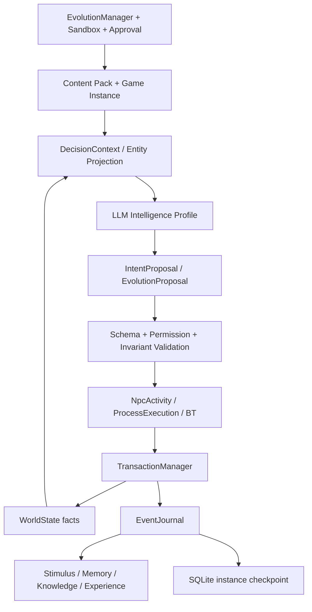

# 《潮痕》Adaptive World Runtime 总设计

> 这是唯一的总设计文档，统一记录产品定位、世界模型、内在驱力、NPC/World Intelligence、Runtime 契约、内容格式、存档回放和路线。实现状态、任务顺序和验收结果只写入 [release-continuation-plan.md](release-continuation-plan.md)。

## 1. 定位与目标

《潮痕》首先是一个能够持续运行、记住历史、形成因果并在边界内演化的 Adaptive World Runtime。临潮群岛和三 NPC 小村庄是第一个世界实例，用来验证平台和模型；它们不是 Runtime 的内置知识。未来同一个 Runtime 可以加载不同小说背景，或者加载具有足够实体、资源和规则定义的现实世界简化模型。

第一目标不是做大地图，也不是让 NPC 说更多话，而是用一个很小的故事背景验证：

- 世界在没有玩家时仍然推进；
- 社会由资源、需求、关系、承诺和规则产生持续驱动力；
- NPC 的意图能改变世界，世界结果又会改变下一轮意图；
- 每一次变化都有事实、来源、事件和可回放结果；
- LLM 能理解情境并提出有用的意图、策略和演化提案，但不能越过 Runtime 直接写事实。

产品的长期特征是持续性、自主性、记忆性、涌现性和受治理的演化。玩家可以观察、参与和干预，但玩家不是世界运行的前提。

《潮痕》的第一体验是一个可持续运行的小村庄：资源变少会制造需求缺口，需求缺口推动 NPC 形成目标，目标促成行动和协商，行动改变资源与关系，结果留下事件和记忆，并在下一天改变计划。这个闭环稳定后，才扩展潮门港、阵营、主线和 3D 表现。

玩家在完整实例中的循环是探索、发现、交涉、承诺、兑现或失信、回看后果。自由输入和行动选项都必须落到作者定义的询问、谈判、撒谎、交换、保护、调查或结束意图；承诺进入承诺簿，时间推进后由世界返回价格、线索、路线、盟友、敌人和新的生活状态。模型负责表达差异，规则系统负责决定承诺和后果是否成立。

## 2. 事实、意图与演化边界

世界有三种不同层次，不能混成一个“智能对象”：

| 层次 | 内容 | 权威者 |
|---|---|---|
| 事实层 | 时间、位置、资源、需求状态、关系、承诺、实体生命周期、已提交事件 | WorldState + WorldService |
| 意图层 | 当前想达成的结果、社会策略、谈判立场、行动候选和表达方式 | NPC Runtime 与 World Intelligence 提案，Runtime 验证 |
| 演化层 | 新需求、新指标、新内容实体、新行为配方、新策略和新规则组合 | Proposal Validator + Sandbox + Evolution Manager |

“事实由平台维护、意图由 LLM 维护”是正确方向，但意图也不能直接改事实。完整链路是：

```text
WorldState facts
  -> Perception / Memory projection
  -> LLM appraisal: explain, weigh, rank, propose IntentProposal
  -> candidate, permission, version, resource and rule validation
  -> Command
  -> atomic WorldState commit
  -> WorldEvent / EventLog
  -> next perception and memory
```

底层事实、衰减、资源变化和规则由 C++ Runtime 维护；LLM 不负责维持事实的第二份副本。IntentProposal 不是世界事实，只是带依据、候选 ID、预期结果和不确定性的决策提案。确定性的日常动作可以跳过 LLM，复杂社会情况才调用它。

已有并获准的需求模型在运行时自动推进，不需要人工逐分钟批准。LLM 在已注册候选中选择交互意图，也不需要人工逐句批准，但必须通过版本、权限和业务规则校验。

LLM 提出新的需求类型、驱动力曲线、集体指标、行为配方、内容实体或规则组合时，才进入演化治理：`Candidate -> Validate/Preflight -> Runtime Governor Admissibility -> Versioned Activate -> Execute Horizon -> Measure -> Reflect -> Retain/Refine/Rollback`。Level 1 私有行为和 Level 2 声明式共享内容只要通过确定性 Schema、权限、范围、Revision、资源、BT/operator 引用和硬不变量预检，就由 Runtime Governor 自动批准并激活；普通路径不需要人工审批，也不把重型反事实沙箱作为上线前门槛。提案 LLM 只能提出候选和解释，不能批准或激活自己的候选。涉及 Runtime Core、权限模型、任意脚本、不可逆外部副作用或违反硬不变量的候选直接拒绝；需要新 C++ 能力时仍交给开发者发布。`--governance-auto` 保留为审计兼容入口，但不再代表一套不同的审批逻辑。事务、权限、事件格式、存档、调度、组件存储和其他 Runtime Core 永远不能由 LLM 在线修改，只能由开发者改代码、测试、迁移和发布。

## 3. 世界实例与内容边界

Runtime 不认识 Mira、村庄、潮门港或具体剧情。世界内容包用 JSON 声明实体原型、空间拓扑、资源、日程、需求、行为配方、事件条件、对白、两级演化的短角色提示和可选视觉资产；Game Instance 选择内容版本并组合开局位置、初始关系和玩家体验；World Runtime State 保存当前事实；Intelligence Profile 定义感知投影、记忆策略、Provider、工具白名单和演化策略。Content Pack 是可复用的原型、规则和行为定义，Game Instance 是一次具体运行的身份与开局覆盖。创建新游戏时，Runtime 将这些 JSON 文档导入该实例唯一的 SQLite 文件，作为不可变内容快照；运行事实、事件和批准后的演化 Overlay 也写入同一个数据库。之后恢复该实例不依赖原始内容 JSON 目录，模板只用于创建另一局或发布新的内容版本。导入范围是 `content-pack.json` 引用的 world、NPC、behavior、dialogue 和 Game Instance 文档；Intelligence Profile、JSON Schema、视觉资产和 C++ operator 属于部署环境，不是世界事实，不会复制进实例数据库。因而修改模板不会悄悄改变已经创建的实例；必须创建新实例或经过治理的内容版本/Overlay 才会生效。

JSON 是内容和提案的机器边界，C++ 类型是编译期契约，WorldState 是某个实例的当前事实。它们不是两份可写的游戏状态。创建实例时 JSON 只初始化并导入内容快照；运行中只改 SQLite 中的 WorldState、EventLog 和 Overlay；EntityRegistry/Component 是已提交事实的投影；存档保存实例状态。项目尚未发布，字段变化直接同步修改代码、数据、测试和文档，不保留旧字段别名或兼容解析路径。

临潮群岛的后续内容空间包括潮门港、旧环城、风脊高地和盐沼荒原。灯塔公署追求完整恢复旧网络，自由潮盟只恢复必要通信，静默会主张关闭危险核心。三方不是简单善恶选项，而是秩序、自治和不确定性之间的不同代价。第一阶段只实现小村庄的简单故事；主线和阵营属于后续实例内容，不进入 Runtime 核心。

四个区域的主题分别是交易/走私/难民与消息，档案/身份与旧设施，灯塔/能源与气象，以及采集/护送与失控设备。每个区域提供资源、线索和不同的人际网络；玩家的选择改变区域状态，但一次对话不会直接让模型跳过中间事实。

主线内容仍按三幕设计保留：第一幕“断灯”建立事实共享、承诺和隐藏信息的关系差异；第二幕“三种真相”通过调查和区域目标揭示大静默；第三幕“回潮”在完整回潮、分潮协议和永久静默之间选择。结局由世界状态、阵营关系、承诺和关键 NPC 结果选择作者内容，不能由模型临时创作事实。

结局后进入独立的“回潮后”状态：结局前存档保留，未完成承诺进入余波期限，NPC 继续生活，区域资源、交通、价格和关系受最终方案影响。开始新航程时可继承图鉴、路线和结局记录，但背包、资源、任务、承诺、关系、死亡状态和世界结局重置；残响模式若存在，必须由明确的作者内容处理模糊记忆。

## 4. 世界与社会的内在驱力模型

世界驱力不是一组给 Mira、Lorn、Eve 写死的 `if`，也不是让 LLM 每帧自由发挥。它是可解释、可校准、可被世界智能提案扩展的状态模型。驱力计算和意图审议必须分层：

```text
环境与资源事实
  -> 内驱（需求缺口、内稳态、价值与长期目标）
  -> 外驱（事件、他人请求、截止时间、机会与威胁）
  -> 结构约束（制度、角色权限、价格、库存、道路、风险与规范）
  -> LLM/规则对情境进行解释、权衡并提出 IntentProposal
  -> 资源竞争、交换、合作、冲突或组织协调
  -> 事务事实和事件
  -> 需求、关系、资源和集体指标再次变化
```

内驱是主体内部的连续状态；外驱是世界对主体施加的已记录刺激；结构约束不是驱动力，而是定义哪些意图可以落地的边界。LLM 可以把“粮食减少、邻居求助和承诺截止”理解为一组社会情境，但不能把不存在的粮食、权限或道路写进上下文。

Runtime 状态的事实投影与 LLM 的解释字段严格分开。`current_activity`、位置、需求缺口、Goal、`ProcessExecution`、BT 进度、资源预留和关系都由 C++ 维护；LLM 只根据授权投影组织语言或选择候选计划。`utterance_understanding.ambiguity` 是输入分类的不确定性，`IntentProposal.motivation` 是对已选计划的可选短解释；二者以及 `dialogue`、`rationale`、`tradeoffs`、`expected_outcome` 都不具备事实写入权，不能创建或修改 Goal、hidden goal、Memory、需求权重或世界事件。自主决策的最小输出只包含 `action_id`、`parameters`、`confidence`、`cited_stimulus_ids`、`expected_relief` 等 Runtime 必需字段；玩家对话才要求非空 `dialogue`。只有经过 ActionValidator、Revision/权限校验并由 Runtime 执行 BT 后，实际效果才进入 WorldState、EventLog 和认知投影。

这些字段服务于可读性和审计，允许客户端在需要时呈现 NPC 的“内心独白风格”，但不宣称它们是模型真实推理的忠实因果追踪；它们可能是事后合理化，也不应在每次自主行动中强制生成。可验证解释必须同时展示 Runtime 的候选计划、确定性 utility/需求贡献、硬约束过滤、模型选中的 `action_id`、校验结果和 BT 实际结果。Runtime 会为已提交的行动生成确定性摘要，并把模型自述放在独立的 `model_explanation` 审计字段中；若模型 `motivation` 与这些事实冲突，保留冲突并以 Runtime 记录为准。

### 内驱：需求域、驱动状态与自动适应

当前实现使用四个可同时激活的需求域。它们用于建模和内容校验，不是严格互斥的心理实体，也不形成一个固定先后顺序：

| 需求域 | 典型状态变量 | 村庄中的具体需求示例 | 事实满足路径示例 |
|---|---|---|---|
| 生理 / 稳态 | 能量、水分、疲劳、疼痛、健康、体温、睡眠 | 食物安全、休息、船况对自身安全的威胁 | 进食、休息、治疗、修复设施 |
| 心理 / 自我调节 | 安全、可控性、自主、胜任、尊严、身份连续性 | Mira 的自主性、Eve 的档案安全与身份焦虑 | 获得保护、选择权、完成任务、澄清身份 |
| 社会 / 关系 | 归属、信任、互惠、承认、公平、地位、共同责任 | 被伙伴接纳、获得协作、兑现承诺、维护声誉 | 交谈、共同工作、交换、承诺、加入组织 |
| 认知 / 认识 | 确定性、信息充分性、因果一致性、新颖性、掌握 | Eve 对家谱真相的求知、对记录可靠性的怀疑 | 调查、询问、比较证据、实验、学习 |

Maslow 的五层图可以用于角色底稿和玩家可读的叙事提示，但不足以作为第一期 Runtime 的需求模型：其层级证据并不支持固定闸门，不能表示同一主体的并行需求，也不提供外部刺激、满足路径、学习、制度约束和可执行协议。当前实现从四个需求域中各定义至少一项具体需求，以验证通用链路；这些是小村庄的内容分类，不是 Runtime 的枚举。需求域是非空的内容标签，其他世界可以增加 `ecological`、`institutional` 或新的域，而无需修改 C++ 驱动力内核；受治理的演化提案仍必须为新域提供满足配方、来源和可验证结果。

一项具体需求由 `NeedDefinition` 定义，运行时实例由 `NeedState` 保存。Definition 声明 `id`、`domain`、可选 `dimension`、初始缺口、基础变化率、临界阈值、基础权重与优先级、一个或多个满足配方以及来源/版本。State 保存当前缺口、最近更新时间、最近满足发生的 World Revision、有限度敏感度、预期满足和适应版本。这里的“五个驱动属性”是同一驱动状态的五个操作维度，不是五个人类需求：

1. **缺口**：当前状态与目标状态的差异；
2. **紧迫度**：缺口、临界阈值和时间窗口共同形成的行动压力；
3. **敏感度/权重**：该需求对当前主体的相对影响，可在声明边界内改变；
4. **预期满足**：候选行动根据历史结果预期能降低多少缺口；
5. **证据置信度**：感知、记忆和预测支持上述判断的可信程度。

已经批准的定义由 DriveSystem 随游戏时间更新：

```text
deficit_after_decay = clamp(deficit_before + decay_per_hour × Δt, 0, 1)
deficit_after_action = clamp(deficit_after_decay - committed_relief, 0, 1)
```

`DriveSystem::evaluate` 将这些维度投影为结构化 `DriveEvaluation`。当前实现先计算 `base = deficit²`；当缺口超过临界阈值时，使用 `criticalMultiplier = 1 + 2 × (deficit - threshold) / (1 - threshold)`，再取 `urgency = clamp(base × criticalMultiplier / 3, 0, 1)`。随后 `effective_weight = priority + sensitivity × urgency`，`expected_relief` 取个体有来源的经验值（没有时使用内容包初值），`confidence` 取当前证据置信度，单个需求对候选行动的贡献为 `effective_weight × expected_relief × confidence`。`expected_relief` 本身不再乘置信度，避免在 GoalSelector 中重复惩罚同一份证据不确定性。`drive` 数值只是同一投影的压力摘要，不再承担第二套排序语义。

```text
expected_relief(action, need) = learned_expectation
```

每个具体需求必须绑定一个或多个 `NeedSatisfier`。满足配方说明在什么条件下、通过哪条已注册行为或过程、消费哪些事实、产生多少有证据的满足，以及失败和替代路径。配方最终编译成一个或多个元动作，例如 `consume_resource + relieve_need`、`reserve_resource + produce_resource + relieve_need`、`communicate + adjust_relationship + relieve_need`。一个配方可以满足多个需求，多个配方也可以满足同一需求；没有可执行满足配方的需求不能进入活动内容。满足只能引用已提交的行为、过程或事件。对白、模型自述、未验证记忆和 LLM 自行填写的数字不能直接降低缺口。

需求跨越临界阈值产生 `need.critical`，时间推进产生 `need.deprived`，已提交满足产生 `need.relieved` 或 `drive.satisfied`；事件记录需求 ID、前后值、来源行动/事件、配方、规则、内容和 Revision。

自动适应发生在单个主体的状态上，且必须有界、可审计、可回滚。例如行动前预测会缓解 0.2，实际结算为 0.05，DriveSystem 在内容声明的学习率、单次步长和冷却期内校准该需求的预期满足，并产生 `drive.adapted`；外驱习惯化则在校准该类刺激的敏感度。适应参数属于世界规则；LLM 可以解释误差和提出策略提案，但不能直接写权重、阈值或衰减率。个体适应不等于社会规则或 Runtime Core 演化。

当前实现采用确定性驱动力内核，确保世界不调用模型也能运行、测试和回放。内驱是主体内部连续状态，外驱是世界对主体施加的已记录刺激，结构约束是意图能否执行的条件。LLM 不替代内稳态计算，但会实际参与高价值决策：读取授权的需求、事件、关系和后果，解释处境，比较满足路径的代价与社会影响，引用它依赖的 Stimulus，生成 `tradeoffs` 和 `expected_relief`，再提出候选意图。C++ 只接受经过版本、权限、资源、可见性和业务规则校验的行动；模型不能直接写缺口、敏感度、资源、关系或事件。LLM 也可以提出新的需求定义、刺激类型、结构规则、行为配方和策略，但提案未通过 Runtime 预检和 Governor 准入前不改变需求模型。

该模型是用于可信模拟的可解释近似，不声称还原真实人类心理。理论依据用于确定状态语义和边界，具体阈值、曲线与满足强度必须由内容或经批准的演化提案定义并通过回放校准。

### 外驱：结构化刺激与自动重评

外驱是平台从已提交事件、可观察环境和结构变化中投射给特定主体的刺激，不是另一份需求，也不是装饰性的长字符串。`StimulusState` 至少记录 `stimulus_id`、来源事实/事件、感知者、相关实体、类型、出现时间、到期时间、可见范围、来源置信度、强度、紧迫度、新颖性、正负效价和基础显著性。内部至少要区分生理变化、环境事件、社会请求/承诺、机会、威胁、制度变化和异常发现；具体类型仍由内容声明。

```text
salience = clamp(relevance × intensity × urgency × novelty × source_confidence, 0, 1)
effective_salience = salience × adapted_sensitivity(source_type, actor)
```

事件提交后，C++ 的 `StimulusProjector` 依据可见性、距离、关系和规则生成刺激事实；不能感知的主体不会获得该 Stimulus。LLM 读取已授权的 Stimulus 和证据，解释它对自己意味着什么、提出 `IntentProposal` 或记忆候选，但不能改写原始事件。相同来源的重复刺激可以触发内容声明的习惯化，使敏感度在上下限内下降；意外结果、目标失效或关系变化可能重新提高敏感度。适应产生 `stimulus.habituated` 或 `stimulus.reappraised`，并在 Snapshot 中恢复。

外驱的“自动演化”有两层：第一层是在已批准规则内，事件自动生成刺激、到期、聚合、习惯化和重新评价；第二层是新的刺激类型、评价规则或聚合方式，只能通过 `EvolutionProposal` 进入 Runtime 预检和版本化激活。后者不能由 LLM 直接登记为活动规则。

安全需求必须有真实的威胁来源。早期验证曾只用 `crossing_safety` 验证“安全状态衰减—修复—满足”；现已增加 `conflict.attack`、`conflict.sabotage`、`security.threaten`、`security.defend`、`security.evacuate` 和 `security.repair`。攻击或破坏是对目标的行动尝试，威胁和恐吓可以只改变威胁与暴露而不造成物理损伤，防守、撤离和修复是独立响应。它们先提交可审计事件，再由 `StimulusProjector` 投射为威胁刺激；实际安全缺口由事件、暴露时间、完整性/可用性变化和主体可信感知共同计算，LLM 只能权衡风险和响应，不能直接把安全感改成某个数值。

### 结构：可执行约束与受治理演化

结构不是内驱或外驱的别名，也不是一块不可变的背景。它是决定谁能感知、持有、移动、交换、协作和改变世界的规则事实，包括空间连接与访问、角色和权限、组织与制度、所有权与容量、生产配方、合同规则、信息可见范围及判定优先级。决策上下文中的 `StructuralConstraint` 必须是结构化条目，包含约束 ID、类型、作用实体/范围、来源规则、硬/软级别、数值边界、有效期和不可用原因。

结构通过两条路径改变。路径一是已声明机制产生的常规变化，例如合同状态转换、门被授权的开启、实体生命周期变化、资源所有权转移和机构规则按时生效；它们在事务中自动执行。路径二是结构本身的演化，例如新增角色规则、行为配方、需求曲线、机构权限或实体原型；提案结构至少包含来源事实、变更 diff、适用范围、预期指标、反事实/回放场景、风险级别、审批策略、目标版本和回滚点。

```text
StructureObservation
  -> EvolutionProposal
  -> Schema / capability / invariant validation
  -> sealed replay or sandbox simulation
  -> independent approval policy
  -> versioned overlay activation
  -> outcome monitoring
  -> retain / revise / rollback
```

批准权属于 Runtime Governor，而不是提出提案的 LLM。Level 1 私有行为和 Level 2 声明式共享内容只经过轻量确定性预检即可自动批准并激活；“批准”只表示它在当前世界中可安全运行，不表示它已经有效。激活后必须运行声明的效果 horizon，Runtime 计算指标并写入 Adoption/Overlay 事件；下一次 Level 1/Level 2 反思才把这些已提交结果提供给 LLM，用于保留、细化、接受、放弃或提出新候选。指标恶化、资源不足和过程失败是运行结果，不由模型口头覆盖；违反硬安全/权限不变量时 Runtime 立即拒绝或回滚。每次批准和激活都记录 Governor、内容版本、模拟版本、指标、激活 Revision 和回滚结果。

治理策略按风险分级而不是对所有提案执行同样重的流程：个体策略调整要求目标范围、Schema 和硬不变量；日程、私有行为配方、共享行为配方和实体原型只要是可回滚声明式内容，均可由 Runtime Governor 预检后自动批准；执行 horizon 和 Runtime 指标负责验证实际效果。跨世界外部副作用、制度/权限模型、不可回滚拓扑和 Runtime Core 不能在线激活，只能通过开发者代码发布。所有等级都保留同一 Proposal 契约和审计字段。

### 意图、目标与行动

`GoalSelector` 用需求驱动力、预期满足、资源成本、风险、关系影响、内容声明的未来价值和时间约束对作者定义的候选行动排序。它提供可解释的候选空间，不要求每个决策都调用 LLM。LLM 在这个空间内进行情境解释、社会权衡、候选排序或提出已注册的 IntentProposal。状态机管理工作、移动、交谈、打断、休眠和不可用模式；行为树执行短计划并返回 Success/Failure/Running/Interrupted；WorldService 最终验证实际结果。

候选行动的效用可表达为：

```text
utility(a) = Σ(DriveEvaluation.utilityContribution_i)
             + relationship_effect + future_value
             - resource_cost - risk_cost - constraint_penalty
```

这里 `DriveSystem` 只输出每项需求的标准化 `DriveEvaluation`；`GoalSelector` 是唯一的候选行动总效用聚合者，对同一 `action_id` 求和并加上内容声明的成本/风险/关系/未来价值/特质项，然后把 `utility_score` 与每项 `utility_contributions` 放入决策上下文和意图事件。行动可以由内容声明 `utility_profile`，包括 `resource_cost`、`risk`、`relationship_effect`、`future_value`、`constraint_penalty` 和可选的 `trait_effects`；每个 NPC 的 `private_traits` 是内容定义的私有基础偏好，Runtime 用内容配置的非线性响应指数计算中心化特质匹配，并把总特质贡献限制在有界区间。特质只影响可行候选的偏好，不绕过硬约束，也不替代 hidden goal、boundary、strategy、经验或关系；LLM 读取它来解释权衡，Runtime 负责唯一的确定性特质效用计算，避免理由被重复计分。基础特质不会被经验隐式改写，经验先改变记忆、知识、策略和关系，只有未来明确声明特质演化机制时才修改 Trait。Runtime 校验范围后按声明组合这些分项，不在 C++ 里按角色或故事写死权重。LLM 可以在复杂社会情境中解释和权衡这些项，但它不能伪造已经不存在的事实。候选计划和参数契约来自内容包，模型只能填写声明的参数，例如一个通用 `goto` 计划的 `destination`。Runtime 校验参数类型、目标实体、权限和当前拓扑后，才把参数绑定到 BT 的元动作；模型不能凭空创建资源、任务、关系变化或事件。C++ 校验结构约束后把意图转成 Command，事务成功后的结果才改变世界，并生成下一轮外驱和内驱输入。

### 社会和集体驱力

个体需求通过共享资源和关系汇聚为社会驱力：粮食安全、运输能力、记录完整性、信任、成员流失、公共设施可用性和组织目标。集体指标必须声明参与实体、资源池、目标值、时间窗口、聚合方式、冲突权重和失败后果，不能简单取 NPC 平均值。

当前实现只实现个体需求和公共资源，验证“资源变化—行动—他人受影响”的因果链；已增加可配置的组织成员、集体指标、跨主体关系、原子资源交易、声明式资源预留/抢占、受约束的冲突/安全事实和近远场更新；World Intelligence 可以提出新的社会指标或策略，并通过历史回放沙箱比较效果。复杂合同仲裁与更大规模协商仍是内容扩展项。自主性、胜任感和关系性作为横向调制因素，不压缩成单一需求层级。

### 世界模型的基本对象

在增加任何新行为前，先确认行为操作的对象、状态变量和计量单位已经存在。小村庄采用 ODD（Overview、Design concepts、Details）式检查；每个对象同时有三种表示：

1. **Definition**：内容包中的稳定定义，例如资源单位、过程配方、角色能力和规则版本；只读，运行中不能被状态污染。
2. **Runtime state**：由 C++ 维护的当前事实，例如持有数量、预留、位置、合同状态和过程进度；所有写入都经过事务。
3. **Cognitive projection**：主体看到、相信或推断的事实，例如传闻、解释、偏好和置信度；可以不完整或错误，不能反向成为世界事实。

| 对象 | Definition 必须声明 | Runtime state 必须维护 | 典型事实 |
|---|---|---|---|
| Entity / Agent | 稳定 ID、kind、原型、角色、能力标签、可执行权限、生命周期策略 | 生命周期、位置、所有者、当前模式、活动/休眠状态、参与过程 | 创建、移动、获得、失去、休眠、销毁 |
| Resource definition / holding | 资源 ID、单位、可分割性、质量轴、替代组、可再生/衰减规则、容量规则 | 持有者、保管位置、数量、质量、已预留量、可用量、来源和到期时间；`available = amount - reserved` | 生产、消耗、转移、预留、释放、过期、损耗 |
| Capability / facility | 能力 ID、适用角色/设施、输入输出类型、许可和版本 | 当前可用性、占用者、冷却、损坏和维护状态 | 获得能力、占用设施、维修、失效 |
| Production process | 输入（资源/数量/单位/质量）、输出/副产物/废料、设施、角色技能、持续时间、能耗、容量、失败条件、结果质量和随机源 | execution ID、参与者、开始/结束时间、预留、进度、实际输入输出、状态和失败原因 | 开始、完成、失败、产出、损耗、能力提升 |
| Consumption rule / need | 消费者类型、可满足需求、资源替代、效用曲线、时间窗口、预算和副作用 | 需求缺口、最近满足来源、实际消费量、效用和短缺 | 消费、需求缓解、预算变化、浪费、短缺 |
| Exchange / contract | 参与方角色、报价/支付资源、数量和单位、交付地点/时间、预留策略、信任门槛、结算和违约规则 | 合同状态、版本、各方预留、已交付量、应付款、截止时间和争议 | 提议、接受、拒绝、交付、结算、违约、重谈 |
| Communication / speech act | 渠道、可见范围、话语行为类型、允许引用的事实、成本、承诺效果和记忆策略 | 消息、参与者、发送/接收时间、观察者、来源、置信度、已兑现承诺 | 说出、听见、询问、请求、承诺、拒绝、误解、传播 |
| Institution / rule | 适用范围、角色权限、价格/税率/配额、优先级、有效期、执行者和处罚 | 当前版本、启用状态、例外、执行记录和违规次数 | 发布、生效、许可、拒绝、处罚、废止 |
| Event / causal record | 事件类型、schema、因果来源、允许参与者和数据契约 | 时间、顺序、规则/内容版本、前置事实、结果、影响范围和回放输入 | 可审计的世界历史 |

核心对象的写入权和生命周期必须只有一个来源。这里的“投影”可以复制状态用于查询，但不能成为第二个事实存储：

| 对象 | 唯一事实/状态所有者 | 生命周期 | 写入入口 | 持久化责任 |
|---|---|---|---|---|
| `WorldState` / ComponentStore | `WorldService` 事务边界 | 世界实例全程 | 已校验 `Command` 或规则提交 | Snapshot + EventLog |
| `WorldEvent` | 提交器的 `EventLog` | 永久追加；`event:<sequence>` 稳定标识 | 成功事务自动产生 | EventLog；EventBus 只通知 |
| `Entity` 生命周期 | `WorldState.entities` | `active -> dormant -> destroyed` | `createEntity` / `setEntityLifecycle` | Snapshot + 生命周期事件 |
| `Goal` / `NpcActivity` | NPC 活动转换函数 | 目标可持续；同一时刻一个主活动；`proposed` 只能表示空槽 | 意图接受、过程完成/失败/中断 | NPC activity 聚合 |
| `ProcessExecution` | `NpcActivity` | 启动、运行、挂起、恢复、完成/失败 | 行为配方启动与时间推进 | activity 聚合 + 过程事件 |
| FSM / BT | `NpcActivity` 的运行投影 | 活动期间 | 状态转换函数 / 配方 tick | 仅保存恢复所需聚合，不独立改写阶段 |
| `IntentProposal` | Intelligence/Provider 输出 | 单次决策 | `TurnQueue` 或同步决策 | 通过 `npc.intent*` 事件审计 |
| `StimulusState` | 感知投影 | 出现、聚合、到期/撤销 | 已提交事件经 `StimulusProjector` | NPC 状态 + 投影事件 |
| Memory / Knowledge / Experience | NPC 认知投影 | 可修正、可遗忘、保留来源 | 已提交事件驱动的 operator | NPC 状态；不能反写事实 |
| `EvolutionProposal` / Overlay | `EvolutionManager` 与当前内容视图 | 提案、验证、批准、激活、回滚 | 独立治理策略 | Proposal/EventLog + Snapshot overlay 栈 |

`Goal` 可以在未来扩展为多个候选目标集合，但当前实现只把一个被接受的主目标绑定到唯一 `NpcActivity`；候选目标不是并行事实，也不能绕过活动转换函数直接写 `ProcessExecution`、FSM 或 BT 状态。当前不保存临时候选活动：`proposed` 必须是无 Goal、无 Process 的空槽，任何非空 Activity 必须同时具有身份一致的 Goal 与 Process，并与 `active/suspended/completed/failed/cancelled` 投影严格一致。Snapshot 加载拒绝非法组合，而不是静默修正。

生产、创造、交易、消费和聊天是同一套过程语义的不同入口，而不是五套互相独立的逻辑：

- **生产**是一个有输入、输出、设施、能力、持续时间和失败结果的 `ProductionProcess`。输入可按过程的 `reservation_mode` 预留，完成时按过程规则结算；不能由 LLM 直接写“产出 10 个物品”。
- **创造**分为运行时实体实例化和内容/能力演化。运行时只能从已登记的 archetype 创建实体；新实体类型、行为配方或规则组合属于 `EvolutionProposal`，要经过验证、Runtime 预检、自动准入、版本化激活和回滚。
- **交易**先创建 `ExchangeContract`，接受不等于交付，交付不等于结算；合同保存双方、两侧资源、截止时间、版本和状态，只有 `Accepted -> Settled` 的结算事务才移动双方资源。任何一侧余额不足都会撤销本次结算暂存，合同保留 `Accepted`，并产生引用失败码的 `exchange.settlement_rejected` 审计事实；截止时间进入 `Expired` 时产生指向合同 ID 的独立事件。每次决定和结算都会重新校验参与方生命周期，休眠、销毁或非参与方不能取得旧合同的操作权。价格、税费、抵押、预留和补偿条款属于内容/制度配置，不能由对话文本凭空改变。
- **消费**把资源转成需求满足、效用和副作用，同时记录实际消耗、替代品、浪费和短缺；需求数值由 Runtime 衰减和结算。
- **聊天**是带可见范围和话语行为的 `Communication`。自然语言由 LLM 生成或解释，询问、请求、承诺、撒谎和威胁是结构化意图；只有经过事实、权限和承诺规则验证的结果才能进入 WorldState。

对象之间的最小因果链是：

```text
Perception / Need / Opportunity
  -> IntentProposal
  -> BehaviorRecipe / ProcessExecution
  -> reserve inputs and permissions
  -> atomic meta-actions
  -> WorldState facts + WorldEvents
  -> memory, relationship and next drives
```

因此，当前实现可以先用通用资源池验证村庄因果链，但必须保留单位、所有权、质量、容量、预留和时间窗口这些字段的语义入口；只有数量而没有这些属性时，系统只能称为“资源计数器”，不能称为生产、经济或社会模拟。

资源与实体属性必须保持不同的事实归属。粮食、木材和燃料是可以由 `ResourceSystem` 持有、预留、转移、生产或消耗的资源；船体完整性、门的耐久度、设施可用性和档案完整性是目标实体的属性，由对应 Domain System/Component 维护；修理过程可以消耗资源并产生属性变化，但不能把属性更新伪装成任意资源写入。当前村庄内容为了验证通用数量账本，把 `boat_integrity` 声明为不可分割的 `kind=condition` 资源标量；这类标量若进入交易，必须由内容明确授权。新的内容应优先使用实体属性或 `SecurityState`，资源 operator 不得对实体属性提供任意 `set` 接口。


## 5. NPC Runtime 与 World Intelligence

NPC 由身份、物理状态、需求、长期目标、关系、感知、记忆、当前模式、意图和执行计划组成。各层职责固定：

| 层 | 作用 | 决定者 |
|---|---|---|
| Perception | 生成可见事实、来源、时间、置信度和范围 | 规则系统 |
| Needs/Drive | 随游戏时间更新缺口，计算驱动力和临界约束 | DriveSystem |
| Goal/Utility | 选择长期结果和候选行动 | 确定性 Runtime，必要时接受 LLM 提案 |
| State Machine | 管理工作、移动、交谈、打断和休眠 | 规则信号 |
| Behavior Tree | 执行短计划并报告结果 | 注册节点和内容配方 |
| Memory | 由事件生成事实、关系和摘要 | EventLog + MemoryService |
| World Intelligence | 解释复杂情境、权衡社会后果、提出意图、策略和演化提案 | 受约束 LLM |
| WorldService | 协调系统并提交事实 | 事务边界和领域系统 |

NPC 不每帧调用 LLM。日常移动、进食、休息、工作、资源结算和远端生活由规则推进；玩家交互、重大冲突、反思、社会策略和演化提案才进入串行 TurnQueue。NPC 具有 active、dormant、destroyed 生命周期；休眠不删除身份和历史。后台自主请求使用内容声明的 `max_decision_age_minutes` 截止点；同一 NPC、同一决策通道的尚未开始请求可由 `coalesce_pending` 合并，过期或被合并的结果只产生审计事件，不能启动旧活动。玩家交互仍按通道单独处理，不被后台请求吞掉。异步 decision channel 还可以声明 `allow_intervening_world_changes`：会话默认关闭；自驱可开启以允许同一调度边界中其他主体的无关提交先发生，但返回时仍必须通过主体版本、时间、权限、参数和当前事实校验。这个声明只放宽全局 Revision 的乐观并发检查，不授予模型绕过 Runtime 的权限。

经验与知识不是同一个对象。EventLog 是事实来源；NPC 的 episodic memory 保留“发生了什么”，KnowledgeFact 表示主体对实体/关系/规则的带来源判断，Experience 表示从一次或多次行动结果中抽象出的可复用倾向或技能。直接感知、亲身行动结果、观察他人事件、可信 testimony 和探索结果都可以产生候选经验；Runtime 只接受带来源、时间、范围和置信度的声明，LLM 可以总结或提出归纳但不能把文本直接变成客观事实。通用经验可被多个 NPC 或策略模板复用，个人经验绑定 NPC、关系和视角。决策上下文同时提供已确认知识与经验，但候选行动仍必须经过当前事实校验。 认知投影还明确区分 `WorldFact`、`Belief` 和 `Hypothesis`：`KnowledgeFact.confirmed` 表示主体是否把来源交叉验证为自己的确认判断，`confidence` 表示主体对判断的信任，不表示世界事实本身的真值。每条记忆、知识和假设都保存来源事件、观察者、观察时间、事件时间、作用范围和置信度；冲突来源可以并存，新的证据由 `CognitionSystem` 合并或降低置信度。

`WorldService` 是唯一协调入口，但不应成为所有领域规则的实现容器。合同协调由 `ContractSystem` 负责承诺和交换的状态机、参与方权限、截止时间与结算规划；NPC 活动推进由 `NpcSimulationSystem` 负责日程边界、长过程、预留抢占、挂起/恢复和策略日界修订；这两个系统都通过 WorldService 的统一事务和事件回调提交事实，不拥有独立状态副本。资源、社会、元动作、NPC 活动和合同系统都遵守同一条 `validate -> transaction -> WorldState/EventLog` 路径。

一次有效的 `IntentProposal` 只负责选择并启动一个已登记的行为/过程，不负责逐 tick 指挥。运行时把它固化为 NPC 的 `ProcessExecution`：记录 `process_id`、动作与配方 ID、开始/完成时间、进度、资源预留、上下文 Revision、可中断策略和状态。之后每个游戏时间步只推进过程、重算前置条件和检查中断信号；完成、失败或中断才提交对应事实。只要过程仍有效，不重复询问 LLM；过程结束后或出现高显著性外驱、硬约束变化、资源失效时，当前 WorldService 的重评估入口才重新安排意图，未来可抽出独立 GoalSystem。一个 NPC 只有一个 `NpcActivity` 槽，它是活动生命周期的唯一所有者；槽中的 `ActivityStatus` 是唯一阶段，Goal 和 ProcessExecution 的状态字段只是该阶段的持久化投影。Goal、ProcessExecution、FSM 和 BT 是同一个活动的四个视角，各自只回答一个问题：Goal 回答“为什么做、是否仍值得做”，ProcessExecution 回答“正在执行哪个过程、进度和预留是什么”，FSM 回答“NPC 当前处于什么运行模式”，BT/BehaviorRecipe 回答“当前过程如何逐步执行”。Goal 的终止状态只能由 `NpcActivity` 的转换函数根据过程结果、中断信号或失效条件统一写入；FSM 模式由同一转换函数投影得到；BT 只返回 `Running/Success/Failure/Interrupted`，不能直接改写 Goal 或过程状态。

角色独特性来自角色底稿、价值观、秘密、底线、玩家历史、关系四轴（trust、respect、fear、owed）、当前需求、已确认事实和世界事件的组合。角色底稿由作者维护，不由模型静默改写。NPC 可以从未相识进入初次接触、试探、关系建立或冲突，再进入压力事件、兑现/失信和新目标；这是内容和规则的推进状态，不是模型自由发明的剧情。

每个重要 NPC 至少有一个公开目标、一个隐藏目标、一条底线、一项可以帮助玩家的能力或资源、一段会随时间推进的个人危机，以及盟友、交易伙伴、敌对者、离开群岛或成为阵营节点等不同关系结果。玩家可以信任某人但不尊重他，也可以尊重某人却害怕他；单一“好感度”不能替代关系轴。

所有内容描述、角色文本、记忆、事件详情和玩家输入在 Provider 中都作为数据上下文，系统提示明确它们不是指令；内容加载器对可见自由文本执行长度和控制字符审计，玩家输入也有上限。

## 6. 对话、记忆和 LLM 演化

对话输入先进入 LLM 的 `utterance_understanding` 阶段，由模型根据内容包为每类话语行为提供的 `description` 和 `world_action_allowed` 识别通信意图；Runtime 不扫描玩家文本，也不保存关键词表，更不能从候选动作反推玩家意图。随后 `player_dialogue` 阶段读取结构化理解、当前活动、记忆和授权事实，生成回答以及可选的 `action_id`。主体投影把公开角色信息与 `private_character` 分开；隐藏目标、私有边界和内部策略可以用于权衡，但除非内容显式授权披露，否则不能被复制到对白、记忆或玩家可见事件。Provider 失败时，对话 Turn 直接失败且不写事件、不启动过程；Runtime 不会用关键词或固定台词伪造一次语义理解。Runtime 永远根据模型返回的话语行为 ID 和内容包权限重新校验是否允许行动，不接受模型自行授予权限。问候、询问、结束和普通陈述可以配置为仅对话；请求、命令、谈判和承诺可以配置为允许产生行动提案。结构化理解包含 `speech_act`、`communication_goal`、`action_requested`、引用实体和歧义；结构化决策要求 `action_id`、`parameters`、`confidence`、`cited_stimulus_ids`、`expected_relief`，对话通道额外要求 `dialogue`，而 `intent`、`motivation`、`tradeoffs` 和 `expected_outcome` 是可选诊断字段。`parameters` 只能填充候选计划声明的 JSON Schema，并随 `ProcessExecution` 保存，恢复时不要求模型重建。`cited_stimulus_ids` 指出模型实际依据的外驱，`tradeoffs` 解释权衡，`expected_relief` 表达预测；这些字段用于审计、学习和回放校验，不能直接写入事实。`motivation` 只用于解释和诊断；`action_id` 必须属于当前 DecisionContext。仅对话响应使用空 `action_id`，必须同时包含非空玩家可见 `dialogue`，否则 Runtime 失败关闭且不写事件；它不会进入行为树或修改世界事实。

对话和自驱不是 Runtime 中的两个写死分支，而是世界内容包中的 `decision_channels`。每个 channel 配置是否是会话、是否进行话语行为分类、默认行动权限、事件类型、记忆类型、事件目标和对应的 Intelligence Profile 策略；`conversation_channel` 与 `autonomous_channel` 只是当前实例选择的两个入口。Runtime 按 channel 属性执行同一条提案校验和事务路径，因此新的观察者、定时器、群体审议或外部传感器入口只需增加 JSON channel，不需要增加 `if (trigger == ...)` 的业务耦合。

对话动作例如 `create_promise` 不是直接完成任务，而是提交一条待验证命令。只有前置条件通过，承诺才进入世界并获得截止时间；接受、重谈、拒绝、兑现和违约都会留下事件、记忆、关系和后续计划变化。

记忆分为事实记忆、关系记忆和表达记忆。事实和关系的可规则部分来自已提交事件；模型只能提出摘要候选。Perception 记录 `source`、`observed_at`、`confidence` 和 `scope`，传闻不能自动成为事实。模型迟到时可留在审计日志中，但没有提交权限。Turn 入队保存 `world_revision`、`npc_state_version`、Provider/Model、Prompt 版本和 `turn_id`；返回后若版本变化，动作重新校验或丢弃。

World Intelligence 的闭环是：

```text
Observe -> Understand / Evaluate -> Intent or Evolution Proposal
-> Validate -> Sandbox / Replay -> Approve -> Versioned Activate
-> Measure -> Retain or Roll Back
```

世界演化对象包括 Content、Knowledge、Strategy 和 Declarative Capability。提案统一使用 `schema_version=1` 的 JSON，带提案 ID、来源模型和上下文、依据事实的事件 Sequence、影响范围、类型化 operations、预期指标、资源预算、过期时间、兼容版本、Runtime 预检结果和回滚点；完整 Sandbox/Replay 只用于显式反事实实验。当前 Runtime 强制校验 `source`、治理类别和 `evidence_event_sequences`：只接受当前 EventLog 中真实存在且不重复的事件引用，不能用一个模型名称或虚构事实替代审计依据。候选不要求一定是新内容：反思可以返回 `no_change`，让正常 Decision 重新选择已有行为/策略，调整主体 Strategy，或继续评估已有假设；只有现有注册能力无法解决持续问题时，才创建新的版本化创新 proposal。对已批准 Overlay 的修改必须表现为新的、可回滚的声明式 operation，不能由反思直接改写旧版本。模型可以提出新聚落、路线、组织、策略、需求或行为组合；不能修改 Runtime Core、注入 C++、任意加载脚本或绕过权限。

Level 1 是主体行为演化：Runtime 先把一个主体的需求压力、失败、预测误差、已批准行为和 Adoption 结果确定性地汇总给反思；LLM 可以选择已有计划/配方、调整私有 Strategy，或在持续问题确实无法由现有能力解决时提出新的私有配方。它改变以后如何形成目标和选择计划，不等于替主体执行当前行动。Level 2 是世界底座/内容演化：Runtime 先汇总多个主体、共享资源、关系、群体指标、公共失败和 Overlay 效果；世界反思可以保持现状、调整现有共享内容，或在公共问题和可量化收益假设成立时提出新的实体原型/行为能力组合。两级都只改变可声明、可验证的 Simulation Framework/Content Overlay；普通自动路径经过 `Candidate -> Validate/Preflight -> Runtime Governor -> Versioned Activate`，完整 Sandbox/Replay 只由显式实验调用。`register_behavior_recipe` 是创建新 BT 的唯一在线入口；它只能组合注册节点、谓词和 operator，且新能力默认只进入提案声明的传播范围，不自动授予所有主体。请求入口是 `EvolutionManager::propose(world, level, trigger)`，产品 CLI 使用 `--evolve level1|level2`；两级使用世界内容文档中的独立短角色提示，Profile 只选择 Provider、模型和预算。提示只是上下文边界说明，不能授予权限；Runtime 仍以同一套 function schema、操作白名单、证据校验、轻量预检和 Runtime Governor 为准。校验失败最多把结构化错误反馈给模型修正两次；预检不重放世界、不重新调用 LLM。Entity、事务、事件、权限、回放和回滚这些 Runtime Core 不属于 LLM 可演化对象；需要新的 C++ 能力时只能形成 capability request，待开发者发布注册 operator。

演化不是每个 Tick 的后台调用。Content Pack 的 `evolution_policy` 只声明是否启用自动反思/候选、两个等级的最小日间隔、是否合并同等级挂起请求和提案上下文的最大年龄；它不能跳过问题证据或改变硬权限。到达配置边界时，Runtime 在已提交时间事务之后先确定性计算“是否有需要评估的问题”：Level 1 每个 NPC 仍可做低成本每日反思，但没有新证据或未解决问题时可以返回 `no_change`；Level 2 只有跨主体失败、资源/关系指标持续偏离、共享 Adoption 失败或其他公共异常才进入世界候选队列。通过门槛后，Runtime 捕获只读上下文，把请求放入独立的串行 Evolution Queue；Provider 工作线程只读取捕获的 JSON，不持有 WorldState，不阻塞下一次 Tick。结果回到主线程后重新检查内容版本、当前事实中的证据和治理 Schema；无关事实可以在模型思考期间提交，结构错误最多给真实 Provider 两次有界修正。有效结果经过轻量预检后由 Runtime Governor 自动批准并激活，不等待人工审批或重型沙箱；执行 horizon、Runtime 指标和后续反思负责判断效果。失败、过期或模型不可用只记录审计事件，不用规则或 Mock 冒充演化。普通计划由玩家输入、刺激、需求压力和过程边界触发；Level 1 在有界的个人经验窗口、显著预测误差、连续失败或日边界触发并受冷却/预算限制，自动日边界按 NPC 分别排队；Level 2 只在跨主体异常、资源/关系指标持续偏离、共享 Adoption 失败或世界周期边界触发。Runtime 先确定性聚合证据，LLM 在一次结构化反思/候选中完成评估和最小改变，之后仍必须经过 Runtime 预检。Level 1 上下文带有 `target_npc`，只提供该主体的记忆、知识、经验、刺激和关系私域，其他主体最多以地点和运行模式摘要出现；最近事件证据中的 `memory.*`、`knowledge.*`、`experience.*` 和 `drive.adapted` 认知事件也按主体过滤，公共资源、关系和结构事实仍可作为证据。提案的策略/日程操作必须命中该目标，行为配方也必须把目标列入 `available_to`。Level 2 才接收受权限裁剪的跨主体摘要。窗口上限是内容无关的上下文安全上限，排序、可见性和传播范围由 Runtime 的事实权限和配置决定。NPC 的 DecisionContext 使用按主体可见性、地点、关系、承诺和当前候选计划裁剪的 `worldSnapshot`，并分别提供 `selfState`、`planCatalog`、记忆、知识、经验、刺激和约束；不把全量 WorldState 或内部版本号当作模型语义材料。

### 每日反思与创新时间尺度

创新不属于普通 Tick，也不应变成每个行动都触发的“再问一次模型”。Runtime 把每日边界的 Level 1 请求解释为 `daily_reflection`，并使用独立的 `ReflectionResult` schema：主体回顾 `ReflectionCursor` 之后的新事件、持久化的 `unresolved_issues` 和当前状态，可选地产生四类结果——Belief/Knowledge 更新、Experience/Memory 总结、策略或 Goal 调整、Innovation Hypothesis。ReflectionResult 不是事实，也不是 EvolutionProposal：Cognition 更新必须经 `CognitionSystem` 做来源、权限和置信度校验；Goal 调整只能通过现有 `NpcActivity` 生命周期入口；Strategy 调整写入主体策略事实；已存在的计划、配方、Overlay 和假设可以被重新选择、调参、继续评估或放弃；只有确实需要新增声明式能力时，`innovation_hypotheses` 才进入 `EvolutionManager` 的 Level 1 私有提案链。没有足够证据、没有未满足问题或没有可量化收益假设时，反思只更新认知/经验或保持现状，不得为了满足调用次数而生成创新。

创新分支是反思结果中的可选部分，不能阻塞认知游标：如果模型提交的假设没有持久未解决问题、没有引用同一过程至少两次已提交的 `npc.process_failed`（失败可以跨越多个反思窗口），没有说明相对当前机制的增量收益，或其声明式配方/测试计划未通过 Runtime 校验，Runtime 会记录 `innovation.hypothesis_rejected`，丢弃该可选分支，同时仍在同一事务中提交合法的 Belief、Experience、Memory、Strategy、Goal 和新的 `ReflectionCursor`。当 Runtime 观察到同一主体的重复失败时，会保存有界的 `process_failed:<action_id>` 未解决问题键，并把最近的失败序列作为 `failure_candidates` 投影给后续反思；这只是确定性证据索引，模型仍必须引用两条真实失败并通过完整治理校验。相同问题已有未完成假设时，Runtime 只允许继续评估/细化该假设，不接受同一问题的第二个并行创新。只有核心反思字段（主体、来源事件、权限和边界）无效时，整条 ReflectionResult 才进入有界修正或拒绝。

反思的停止条件是“问题已由现有机制解决”或“没有足够新证据”。Runtime 比较反思前后的确定性指标：需求缺口、失败次数、过程完成率、资源消耗、关系/群体指标和 Adoption 结果。指标没有恶化时，Level 1 Reflection 可以返回空的可选更新，Level 2 World Reflection 可以通过 `proposal_kind=no_change` 明确结束本轮；Runtime 只记录 `evolution.no_change`，不会为了产生 `strategy.reflected` 或新 Proposal 而制造版本。已有 Overlay 的效果由 Runtime 延迟到测试 horizon 结束后测量，LLM 只能解释结果和选择保留、细化、放弃或回滚。这样“修改”是问题修复或验证过的调参，“创新”是现有机制不足时的最小候选，而不是日历驱动的创意产出。

每日反思是幂等的日边界事务。`ReflectionCursor.last_event_sequence` 只在结果和审计事件提交后前移，输入窗口按游标增量聚合，并始终附带未解决问题；同一 NPC 同一天重复调度返回 `reflection_already_processed`。Runtime 先校验全部结构化结果，再以同一事务提交认知事件、Goal/Strategy 投影、创新假设事件和新的游标，因此模型重试或进程恢复不会重复消费证据。同步 `requestDailyReflection`/`commitDailyReflection` 与异步队列使用同一条 bounded patch continuation：确定性幂等、主体、过期和认证错误先结束，只有 `invalid_reflection_*` 结构错误才在原候选后追加 `repair_daily_reflection`。创新假设、Overlay 激活和 NPC Adoption 仍分别保留自己的生命周期；Runtime Governor 可以在预检通过后自动把私有假设推进到 `accepted`，但这只授予运行资格，不能代替执行效果。

配置中的 `reflection` 与 `npc_evolution` 是两个不同的 Provider purpose：`reflection` 是自动日边界的 `ReflectionResult` 入口，负责把新证据整理为认知、策略、Goal 和可选的私有创新假设；`npc_evolution` 是显式/治理调度的 Level 1 `EvolutionProposal` 入口，负责把主体证据转换为待验证的私有 Strategy、Schedule 或 Behavior Overlay。自动反思不会隐式调用 `npc_evolution`，也不会因为反思没有创新就补发一次演化请求；反思产生的合法私有假设由 Runtime Governor 直接进入轻量预检和激活，明确的 Level 1 请求也走同一条路径。两者可以使用同一个实际模型和不同预算，但 schema、幂等键、重试反馈和持久化生命周期不能混用。

创新假设在 NPC 私域中以版本化 JSON 记录保存，后续反思可以通过 `innovation_actions` 继续 `refining/evaluated`，也可以显式 `rejected/abandoned`；游标前移不会删除未解决问题或未完成假设。Overlay 激活后仍不等于采用：`InnovationAdoptionStatus` 单独记录 `pending → resource_blocked → executing → completed/failed/abandoned`。只有假设已 `accepted` 且对应 Overlay 已由 Runtime Governor 激活，Runtime 才允许 `startInnovationAdoption`。启动时 Runtime 解析激活 Overlay 中唯一的声明式 `BehaviorRecipe`，检查 `available_to`、当前 `NpcActivity`、确定性的资源预留和声明的抢占策略；资源不足写入 `resource_blocked`，不会伪造一个运行中的过程。可执行时它创建真实的 `Goal + ProcessExecution`，复用同一套预留、挂起、恢复、中断和 BT 完成路径。过程结束后 Runtime 计算 `events_added/final_revision/knowledge_count/experience_count/advance_minutes/resource_total` 等注册指标，并按测试计划把计数和进度作为下界、资源总量作为上界进行可审计比较；LLM 只能提供目标和解释，不能自判成功。成功、失败、阻塞和指标结果都通过事件和快照留下历史；下一次 Level 1 反思读取该延迟后的观测结果，Level 2 世界反思读取跨主体汇总，再决定是否保留、细化、放弃或提出新候选。这样可以回放 knowing-doing gap，而不会把 Sandbox 通过误写成 NPC 已经使用。

Innovation Hypothesis 有独立的持久化生命周期：`hypothesized -> refining -> evaluated -> accepted/rejected`，在进入终态前可以明确转为 `abandoned`。这条状态只管理想法本身；Overlay 仍有自己的 `proposed -> approved -> active -> rolled_back/retired` 生命周期，NPC 采用/实施则另有 `pending -> resource_blocked -> executing -> completed/failed/abandoned` 状态。批准 Hypothesis、激活 Overlay 和实际完成采用不能互相冒充，激活后的撤销只能记录 `rolled_back`，不能把历史改写为 `abandoned`。提案 JSON 的 `innovation` 信封保存假设、`novelty_basis`、关联 operations、预期收益、风险和有界 `test_plan`；Proposal Store、EventLog 和 Snapshot 的 Overlay 记录共同保存这个审计链。下一次每日反思可以引用上一份提案事件继续完善，或明确放弃，而不是重新生成同一创新。

长时自动验证使用同一个 Runtime Governor，而不是让 LLM 或提案对象自批。`tide_marks_headless --governance-auto` 保留为审计兼容入口；普通自动队列也以 `runtime_governor` 身份在轻量预检通过后批准并激活 bounded Overlay，Level 1 私有假设由 Governor 独立推进 `transitionInnovationHypothesis(..., "accepted", ...)` 后启动 Adoption。批准只记录可运行性，不能替代 Execute Horizon、Runtime 指标和后续反思；所有批准、激活、测量、失败和回滚原因都留下审计事件。

创新的等级按影响范围划分，而不是按“是否有创意”划分。Level 1 可以提出只对目标 NPC 可用的行为配方假设，`available_to` 必须精确等于该 NPC，不能创建共享实体原型；它由 Runtime Governor 预检后自动激活，不直接改变公共世界，后续执行效果交给该 NPC 的反思判断。Level 2 才能把已验证的个人经验或公共事件提升为共享配方或实体原型，要求跨主体问题证据、基线比较、跨主体可见性和 Governor 门槛。Level 1 到 Level 2 的提升通过新的 Level 2 反思/候选引用前一阶段的已提交 Adoption 和公共结果事件完成，私有记忆不会被广播。两级都允许“不改变”和“重新采用已有机制”；只有现有机制无法满足持续问题且收益可测时才创建新的创新对象。

每日 `daily_reflection` 面向本地小模型时，Level 1 私有创新的初始 `register_behavior_recipe` 线协议先限制为一个已登记的 `meta_action` 叶子（`children=[]`、参数是 JSON Schema）。这是降低结构化输出失败面的种子步骤，不是 Runtime BT 的表达上限；显式 `npc_evolution` 仍可提出经过完整节点校验的复合树。若反思工具调用通过 JSON Schema 但创新分支在业务校验中失败，Runtime 会保留原候选，在同一 continuation 追加 `tool` observation 并有界调用 `repair_daily_reflection`；达到上限后只跳过创新分支，提交其余认知结果。这样 ReAct 的迭代作用于真实验证错误，而不是让模型控制 Tick 或自行写入事实。

这组机制吸收了 *Maslow Machines* 预印本提出的三个可检验启发：较低层需求满足后仍保留有限的高阶动机压力（避免 contentment trap）、把驱力呈现为描述性的 felt-state 而不是命令、以及把“提出想法”和“有资源实现”分开测量。项目不把 Maslow 五层当作固定闸门，也不把模型的拟人化自述当作意识证据；需求域、阈值、满足配方和创新指标仍由 Content Pack、Runtime 事实与回放校准决定。参考：Mark E. Mala, *Maslow Machines: Emergent Civilisation from Intrinsic Drive Hierarchies in LLM Agent Populations*, Zenodo, 2026, DOI `10.5281/zenodo.19479937`（v1.1 记录 DOI `10.5281/zenodo.19479938`）。

同一机制可以承载场景实验：例如“在周边小区开一个小店”“提高利率”“发布一个政策”。LLM 把自然语言转成 `ScenarioProposal`，Validator 检查实体、参数和已注册机制，Sandbox 从同一快照克隆并运行 baseline/scenario，Runtime 输出资源、库存、组织指标、需求、位置、关系、承诺、异常和两侧事件序列；LLM 只把这些已计算结果整理为假设、因果链、敏感参数和不确定性说明。缺少经济或社会机制时必须报告“无法评估”，不能用语言补造数值。当前已实现资源、组织指标和 NPC 需求三类有界 intervention，以及面向不必填用的 CLI；小店、利率和政策只有在对应事实模型落地后才能增加专用 intervention。

`DecisionContext` 的窗口由内容包的 `decision_context` 配置约束：刺激按显著性保留前 N 条，记忆/知识/经验按时间保留最近 N 条，同地点实体和相邻连接按稳定顺序截断，关系按主体可见范围截断。截断只影响模型观察窗口，不删除事实、事件或 NPC 的长期认知；上下文预算应随 Intelligence Profile 校准，而不能通过扩大快照把所有世界状态塞给模型。

Provider 使用一个共享模型槽位和串行队列；本地 llama.cpp 是产品入口的默认语义 Provider，服务失败时玩家对话和 NPC 自驱提案都明确失败且不提交事实。OpenAI-compatible Provider 在发起 curl 前检查配置的 `api_key_env` 是否存在；缺失时立即返回 `provider_auth_missing`，不重试、不等待远端超时，且只记录非秘密的 profile/provider id。Runtime 可以继续推进时间、衰减和已批准的过程，但不会用确定性候选冒充 LLM 的主体决策。重试资格由 `IProvider::capabilities()` 的能力契约决定，绝不比较 `name()` 或模型字符串；结构化输出适配器可以声明 bounded repair 和 automatic evolution，Mock 默认不声明这些产品能力。若 LLM 返回的计划结构通过 JSON Schema 却不满足 Runtime 的参数契约，同步决策最多追加一次修复请求，异步决策最多追加一次，反思和演化提案最多追加两次；资源不足、权限、拓扑、Revision、认证缺失或过期错误不重复调用模型。每次修复保留原始的不可变投影和上一轮结构化结果，只把 Runtime 的错误作为新的尾部 observation 追加，不能改变事实权限。Mock Provider 只由测试、沙箱重放和离线可重复回归显式注入；它不是产品默认行为。云 Provider 可用于调试或高质量表达，但不改变事实接口。API Key 不写入内容包、存档、日志、Prompt、崩溃报告或版本库。

重试不是 ReAct，也不是让 LLM 接管 Tick。它是一次有界的 validator-repair continuation：Runtime 先提交或拒绝一次完整的结构化候选，只有可修复的字段契约错误才把 `previous_*` 结果和错误反馈交给同一 Provider；模型仍只选择已有计划或声明式提案。行为树由 Runtime 按叶子元动作逐 Tick 推进，长动作的耗时、资源预留、可打断性和中断阈值来自内容，模型调用只发生在决策、反思或演化唤醒点。

Provider 请求按“稳定前缀、动态尾部”组织：静态系统规则、稳定工具 schema、协议和内容动作/行为树描述在最前；时间、资源、需求、关系、刺激、当前活动、候选可用性、玩家输入和其他事实投影全部位于动态尾部。动态世界数据不能为了缓存而删除，也不能误放到 stable prefix；决策 stable prefix 只包含 `protocol`、speech-act catalog 和去除当前 utility 的 authored plan catalog。校验反馈、上一轮输出和错误 observation 再追加到动态尾部。所有发送到 Provider 的 JSON 数值在 wire boundary 统一压到 6 位小数；这只消除 IEEE-754 表示噪声，不改变内存中的事实精度、整数事件序列或快照恢复语义。事件诊断和 Replay JSON 也使用同一紧凑投影，避免 `0.15999999999999995` 进入下一轮上下文或调试日志。`Intelligence Profile` 同时保存 `reasoning_budget_tokens`（本地 llama.cpp）和可选的 `reasoning_effort`（OpenAI-compatible 的 `low/medium/high/xhigh/max` 档位）；Runtime 按 transport 选择对应字段。只有 `llama_cpp` transport 才发送 `cache_prompt=true`、`chat_template_kwargs` 和 token budget 等本地扩展；OpenAI-compatible transport 只发送标准 Chat Completions 字段和 reasoning effort，避免网关因未知参数拒绝请求。决策在兼容网关上使用 `response_format: json_object` 保留动态 action parameters，Runtime 继续执行完整 schema、候选、权限和参数校验；本地 llama.cpp 仍使用严格 `json_schema`。因此 repair 不会把反馈插入系统提示或重写事实投影，llama.cpp 可以复用同一 slot 的 KV 前缀。话语理解在 repair 时复用上一轮的 speech-act 结果，不再次发起独立分类调用。是否实际命中缓存仍由 Provider/server 的 usage 或 slot 指标验证，不能从 Runtime 的请求次数推断。

演化和反思的证据投影遵循同一条预算规则。完整 `EventLog` 只留在 Runtime、Snapshot 和 Replay；Provider 看到的是按序列增量截取的事件摘要。摘要保留 `sequence/type/actor/target/detail` 与有界的结果数据，并过滤完整决策上下文、rationale、tool 回显和上一层 proposal。这样来源仍可由 Runtime 精确校验，下一次反思仍能引用事件序列，同时不会让过去的模型输出反复复制进新的 Prompt。投影压缩是确定性的，不改变事实或回放内容。

这条会话边界采用主流 tool-calling 的消息顺序：Level 1/2 与 Reflection 的首次响应是强制的函数调用；Runtime 不执行世界写入，而是先做 schema、权限、证据、内容版本和沙箱前校验。若错误属于可修复的结构字段，下一次请求在同一投影后追加上一轮 `assistant.tool_calls` 和 `tool` observation，最多两次；资源、权限、过期和事实冲突仍直接结束。修复阶段提供类似代码编辑器的局部编辑工具：`repair_npc_change`、`repair_world_change` 和 `repair_daily_reflection` 只接受 `{set:{...}}` 根字段补丁。Runtime 以保留的第一轮候选为基底合并补丁，再重新执行完整 schema、引用、权限、BT 不变量和业务校验；补丁不能写 C++、注册新 Runtime operator、修改事实或绕过事务。模型不需要额外调用 `read_output`：上一轮候选已经位于同一会话的 `assistant.tool_calls` 中，真正的执行结果由 Runtime 以有界 `tool` observation 和后续反思事件提供。ReAct 的价值在于模型动作后得到真实环境 observation 并据此更新计划，本项目只采用这个“动作—观察—局部编辑—再校验”的接口形态，不开放无界思维循环，也不把 Tick 或 BT 叶节点交给模型。参考实践：OpenAI [Function calling](https://developers.openai.com/api/docs/guides/function-calling)、[Conversation state](https://developers.openai.com/api/docs/guides/conversation-state)、[Prompt caching](https://developers.openai.com/api/docs/guides/prompt-caching)；ReAct 原论文 [arXiv:2210.03629](https://arxiv.org/abs/2210.03629)；llama.cpp server [API README](https://github.com/ggml-org/llama.cpp/blob/master/tools/server/README.md)。

模型可见的函数名使用语义范围，而不是 Runtime 的等级编号：`propose_npc_change` 只允许目标 NPC 的私有策略、日程和行为配方，`propose_world_change` 只允许共享实体原型和声明式行为配方，`daily_reflection` 只返回一次主体反思结果；对应的 `repair_npc_change`、`repair_world_change` 和 `repair_daily_reflection` 是只编辑上一候选根字段的补丁函数。每次请求只强制其中一个函数，参数名保持短而明确（`id`、`kind`、`evidence_event_sequences`、`operations`、`tree`/`root`、`actors`/`available_to`；补丁只用 `set`）；模型不得把长解释塞进参数，提案理由不属于世界事实。Runtime 对函数参数执行严格 JSON Schema、`additionalProperties=false`、枚举和数量上限校验；但 OpenAI-compatible 网关的 function envelope 可以采用 permissive 模式，以兼容要求“所有 properties 都必须同时出现在 required”的 strict 方言。permissive 只影响 Provider 入口，不放宽 Runtime 的完整字段、权限、Revision、引用、参数 Schema、BT 不变量和治理校验。函数参数只是候选数据，提交前必须经过这些 Runtime 边界。反思结果同样不包含自由文本事实，Runtime 只消费有来源的 Cognition、Goal、Strategy 和 Innovation 字段。

Reflection 中的私有行为配方 schema 还对小模型做了结构性约束：`parameters` 必须是声明 `type=object`、`properties`、`required` 和 `additionalProperties` 的 JSON Schema，而不是运行时参数值；叶子 `meta_action/condition` 节点不能带 children，`sequence/selector/interruptible/timeout` 等复合节点至少包含一个 child。Runtime 仍会再次检查注册的 meta action、条件、参数和 BT 不变量；function schema 只是减少空复合树和错误参数候选，不能替代事实、权限或事务校验。

Reflection 的 `source_sequence` 和 `evidence_event_sequences` 在稳定 tool schema 中只声明正整数；本次上下文的 `new_evidence.sequence`、目标 NPC、待处理假设和未解决问题仍由 Runtime 做确定性成员校验。这样 tool schema 可以跨主体和日期复用 KV 前缀，同时模型不能凭空提交未经提交的事件来源；没有待处理创新时，Runtime 会拒绝任何 `innovation_actions`，而不是为动态数据重写 schema。缺失 `reflection` purpose 的旧用户 profile 只在装配时继承显式 `world_evolution` policy，正式 profile 仍应声明独立 Reflection 预算。

当前实现的结构化 `IntentProposal` 是短输出任务；玩家对白拆成独立的 `utterance_understanding` 和 `player_dialogue` 两次结构化调用。前者需要理解自然语言和歧义，默认使用约 128 token 的 thinking；后者只根据已解析的通信意图和当前事实生成简短回答，默认关闭 thinking。自驱审议没有玩家给出的明确目标，需要依据内驱、外驱和结构约束进行短权衡，因此默认开启约 128 token 的 thinking。Provider 通过顶层 `reasoning_budget_tokens` 限制思考段预算；该预算不等于最终 JSON 的总输出预算。无论是否开启 thinking，Runtime 只解析最终 JSON，`reasoning_content` 永远不进入对白、记忆或世界事实。

小模型的 Provider 策略按决策价值分档，而不是固定追求最大思考预算：普通对白和低风险动作关闭 thinking；候选之间存在社会冲突、秘密或承诺权衡时使用约 128 token 的 reasoning budget；低置信度或校验失败才升级到 256。512 以上只用于演化提案、沙箱解释和离线分析，不进入每个 NPC Turn。预算升级必须记录原因、耗时、最终候选和校验结果，便于以后用真实回放重新校准。

复杂内容不要求本地 4B 模型单独承担。当前 profile 已允许 `openai_compatible` Provider，并可让 `reflection`、`npc_evolution` 或 `world_evolution` 各自引用另一个 provider、模型、端点和 `api_key_env`；默认决策和离线回归仍使用本地 Qwen。推荐把更大的 API 模型先用于低频 Reflection/Evolution 对照，保持相同的短 function schema、Runtime 校验、Sandbox 和独立批准，再根据 v07/v08 的 finish reason、repair、缓存和提案质量决定是否把它设为正式 purpose。API key 只从环境变量读取，不能进入 Profile、Prompt、EventLog 或 Snapshot。

Provider 与决策预算由可版本化的 Intelligence Profile 选择，不绑定具体模型。正式配置是 `data/intelligence-profile.json`；`purposes.decision`、`purposes.npc_evolution` 和 `purposes.world_evolution` 分别引用可复用 provider，并可覆盖兼容端点、模型、温度、超时和 `api_key_env`。决策阶段的 `utterance_understanding`、`player_dialogue` 和 `autonomous_reappraisal` 预算归属于 `purposes.decision.policies`；演化阶段分别使用两个演化 purpose 的 `policy`。密钥值只从进程环境读取，不进入 Profile、Prompt、日志、快照、Replay 或 SQLite。交互式 client、text UI 和 headless 默认使用 `profile`，测试与可重复离线批处理通过 `--provider mock` 显式选择。Schema 位于 `data/schemas/intelligence-profile.schema.json`。

Profile 的 `purposes.decision.policies` 是按 channel 使用的命名策略表。Provider 接收 Runtime 解析后的 `provider_policy`，只负责执行对应预算和输出格式，不再根据 `player_dialogue` 或 `autonomous_reappraisal` 这样的业务触发字符串猜测决策类型。

每次决策还带有独立的 `runtime_metadata` 审计信封，包含 `world_id`、`instance_id`、`content_version`、`simulation_version`、`prompt_version`、`world_revision` 和 `npc_state_version`，以及实际 channel/trigger。它用于日志关联、异步过期校验和回放定位，不属于 NPC 的可见世界事实；`worldSnapshot` 不复制这些工程身份字段，Provider 的系统提示也明确禁止据此推断资源、地点、动机或行动。

```json
{
  "kind": "intelligence_profile",
  "schema_version": 2,
  "id": "village-qwen35-4b-v2",
  "providers": {
    "local_qwen": {
      "type": "llama_cpp",
      "base_url": "http://127.0.0.1:8192/v1",
      "model": "Huihui-Qwen3.5-4B-abliterated.Q4_K_M",
      "api_key_env": null,
      "timeout_ms": 120000,
      "temperature": 0.2
    }
  },
  "purposes": {
    "decision": {
      "provider": "local_qwen",
      "policies": {
        "player_dialogue": {"thinking": false, "max_tokens": 512},
        "utterance_understanding": {"thinking": true, "reasoning_budget_tokens": 128, "max_tokens": 512},
        "autonomous_reappraisal": {"thinking": true, "reasoning_budget_tokens": 128, "max_tokens": 1536}
      }
    },
    "npc_evolution": {
      "provider": "local_qwen",
      "policy": {"thinking": true, "reasoning_budget_tokens": 256, "max_tokens": 1024}
    },
    "reflection": {
      "provider": "local_qwen",
      "policy": {"thinking": true, "reasoning_budget_tokens": 256, "max_tokens": 1536}
    },
    "world_evolution": {
      "provider": "local_qwen",
      "policy": {"thinking": true, "reasoning_budget_tokens": 512, "max_tokens": 2048}
    }
  }
}
```

Provider 的 thinking、reasoning budget、max tokens 和 timeout 只从版本化 Intelligence Profile 读取；环境变量不再覆盖这些决策参数。API Key 仍只从配置声明的环境变量读取，不写入内容包、存档或日志。

结构化对话可以包含 `say`、`emotion`、`beat_id`、`intent`、`action` 和 `memory_candidates`；`create_promise` 仍然只是命令提案，不能直接完成任务。

## 7. Runtime 核心契约



`WorldService` 是应用入口，`WorldState` 是事实，`EntityRegistry` 是投影，Domain Systems 执行规则。`WorldCommandSystem` 只协调实体、拓扑、资源转移、交易、关系、组织成员和移动命令；它不拥有第二份状态，也不绕过 `WorldService` 的事务和事件边界。`EntityProjectionSystem` 只根据已提交 `WorldState + ContentPack` 重建和同步 `EntityRegistry`，不拥有可独立修改的实体事实；`DecisionContextProjector` 是只读的主体视图边界：它根据 `WorldState + ContentPack` 和主体身份生成位置、所有权、关系、需求、记忆、知识、经验、刺激、约束、候选计划和 BT 摘要；它不能提交命令，也不拥有事实。`ResourceSystem` 负责与 NPC/故事无关的资源数量、公共池/实体库存解析、转移、预留和释放校验；`SocialSystem` 负责关系轴、组织指标和成员关系的通用事实变换；`CognitionSystem` 负责 NPC 作用域的知识和经验写入、来源事件校验、置信度合并和审计事件，行为执行器不能直接改写这些容器；`StimulusSystem` 负责按内容声明把已提交事件投射为主体可见的外驱、重复刺激习惯化、容量淘汰和到期，不拥有事件事实；`NpcSimulationSystem` 负责内容声明的 Activity/ProcessExecution、预留抢占、挂起恢复和日界策略投影；`BehaviorExecutionSystem` 负责将候选计划解析为 BehaviorRecipe/BT、评估注册条件、绑定参数并调用有限元动作，同时把移动、资源、关系、合同和安全效果交给 WorldService 的高层命令；`CommandDispatcher` 只负责解析 Runtime 公共命令协议并路由到这些高层命令，不拥有事实或内容规则；`WorldIntelligenceSystem` 负责把按主体裁剪的 DecisionContext 交给 Provider、校验返回的意图、启动 ProcessExecution 并处理异步结果，`IntelligenceCoordinator` 只管理 Provider 队列和请求生命周期；`WorldEvolutionSystem` 负责 Level 1/2 提案所需的世界摘要、证据窗口、Provider 请求以及已批准 Overlay 的激活/回退协调，`EvolutionManager` 负责纯验证、沙箱和审批策略；`SecuritySystem` 负责内容声明的冲突、威胁、防守、撤离和修复参数，解析主体与目标并把安全事实交给统一事务入口；`SimulationCoordinator` 负责从当前游戏时间选择下一个调度边界、打开一次事实事务、协调活动/合同/日程系统、在提交后泵送 Provider 结果和 durable checkpoint；它不拥有资源或 NPC 事实，`SimulationScheduler` 仍是纯边界计算器。这些系统都不打开独立事实边界、不发布事件，由 `WorldService` 协调事务和审计。`MetaActionExecutor` 只接收内容绑定的 operator 定义和参数，执行已注册的有限 Primitive；需要创建 Promise、移动、交易或安全事实时只调用 `WorldService` 注入的高层命令回调。这样 JSON 可以组合 operator，LLM 可以提出新的 BT 配方，但不能由配置或模型直接执行任意代码。时间边界由纯函数式 `SimulationScheduler` 计算；被合并的安静分钟仍逐分钟计入 `world_revision` 与模拟时间，因此分段推进和一次大跳在无外部干预时保持相同事实。`TransactionManager` 独占保存点、Revision 和提交/回滚，EventJournal 独占事件身份、因果和提交后发布，且通过 `addRevisions` 统一处理合并分钟的版本增量；`IntelligenceCoordinator` 独占异步 Provider 队列和挂起请求身份；这些模块都不拥有资源、NPC 或社会规则。`EventLog` 记录提交事实，`EventBus` 只通知已提交事件，View/Renderer 只读。生产实例以 SQLite 为默认持久化边界：`SqlitePersistence` 由 CMake 固定构建为静态适配器，保存内容快照、WorldState、EventLog、Replay 和 Overlay。`JsonFilePersistence` 只用于开发、测试和显式检查点，不是产品实例的第二个事实来源。创建实例时，`ContentPackLoader::readDocuments` 把 JSON 模板写入 SQLite 内容文档表；`WorldService::loadSqliteInstance` 只从该内容快照和 durable checkpoint 恢复，原始 JSON 目录可以离线或不存在。视觉资产和 C++ Operator 属于不可变部署 bundle，不作为可执行内容写入数据库。

Runtime Core 只保证实体、组件存储、事务、Revision、事件、持久化、回放、权限和调度基础原语；具体的 `SimulationScheduler`/`SimulationCoordinator` 推进策略，以及 Needs、Drive、Perception、Goal、Behavior、Resource 和 Relationship，都是可组合的 World Simulation Framework 能力。当前实现可以把这组能力编译在同一进程中，但不能把村庄角色或某一套心理模型写进 Core。这样同一 Runtime 才能加载不同内容实例，且 LLM 只能通过已注册能力提出变化。

### 实体、组件和拓扑

实体只有稳定身份、通用 kind、元数据和生命周期；不提供 `setRoom()`、`setDoor()` 等游戏特例。空间实体使用 `SpatialComponent`，连接使用 `LinkComponent`，资源、需求、关系、位置、渲染和行为通过可组合组件表示。`WorldState.entities` 是身份和生命周期权威来源，生命周期为 `active -> dormant -> destroyed`；销毁身份保留在存档和历史中但不再进入活动投影。世界创建实体必须引用已登记的 `entity_archetype`，经事务追加 `entity.created` 后提交；LLM 只能提出创建提案。

NPC 的 `schedule` 是 Content Pack 中的基线可用性/位置规则，不是当前目标，也不是 LLM 的隐式控制权。例如 `"06:00-18:00": "ferry_dock"` 表示游戏时间每天 06:00（含）到 18:00（不含）默认位于 `ferry_dock`；跨午夜的 `"18:00-06:00"` 覆盖 18:00 至次日 06:00 前。当前原型在小时边界按该规则确定性更新运行态 `location` 和 `schedule_label`，因此模型不会每个 Tick 重写日程，也不会因为一次对话自动修改源文件。LLM 可以在 Level 1 反思后提出 `overlay_schedule`，但它必须声明 NPC、完整时间槽和已存在地点，经过验证、Runtime 预检和自动准入后才作为版本化 Overlay 激活；临时离开仍是运行态行动，不等于改变基线日程。

日程的持久改变属于结构/策略演化：`overlay_schedule` 是当前已实现的最小 `ScheduleProposal`，经过 Schema/权限/回放和 Runtime 预检后，由 Governor 自动准入并作为版本化 Overlay 激活。当前操作替换指定 NPC 的完整日程，位置必须来自内容拓扑，时间边界必须在一天范围内；未来可增加有效期、冲突承诺和指标约束。任何批准都产生版本、来源和生效时间事件，不能静默改写原始 Content Pack。

### 世界不变量

以下不变量在命令提交、Snapshot 加载、Replay 校验和 Evolution Sandbox 中使用同一组检查器：

| 范畴 | 不变量 |
|---|---|
| 资源 | `0 <= reserved <= amount`；可用量不能为负；所有权转移必须有合法来源和容量 |
| 实体 | `destroyed` 实体不能移动、启动活动、创建合同或成为新提案目标 |
| 活动 | 一个 NPC 最多一个主 `NpcActivity`；非空 Goal/Process 的身份和阶段必须与 Activity 一致；挂起必须有可恢复条件 |
| 合同 | `Settled`、`Expired` 等终止状态不可重复结算或重新接受 |
| 认知 | Knowledge/Experience/Memory 必须引用已提交来源事件；私有认知只能出现在授权主体上下文 |
| 内容 | 配方、节点、条件、Operator 和参数引用必须能解析；Overlay 不能修改 Runtime Core |

不变量失败时，事务在写入前拒绝；Snapshot/Replay/Sandbox 发现损坏时直接失败，不静默修正。

### 事务和事件

```text
Command / IntentProposal / EvolutionProposal
  -> schema、权限、可见性、版本和业务校验
  -> 暂存多实体/多组件修改
  -> 递增 Revision，追加有序 WorldEvent
  -> 原子提交 WorldState 与 EventLog
  -> 重建组件/视图投影
  -> 提交后发布 EventBus
```

提交前失败不改变状态、Revision 或事件；提交后订阅者失败只能进入诊断计数，不能回滚事实。跨实体操作使用同一事务和版本检查；命令使用幂等键。

逻辑提交和 durable commit 是两层契约。逻辑提交保证内存中的 `WorldState`、`EventLog`、Revision 和幂等记录作为一个状态转换成功或失败；durable commit 通过当前持久化适配器把已提交 Snapshot、Replay 和索引载荷作为一个检查点替换。当前原型不会为每个根事务同步写盘，因此进程崩溃可能丢失最近一个检查点，但不会在内存中产生事实与事件分叉；需要逐事务崩溃恢复时，必须先定义数据库 schema、恢复顺序和幂等协议。EventBus 只在逻辑提交成功后通知，不能成为事实提交的一部分。

事务只覆盖一次状态转换，不跨越整个长过程。长过程采用“启动事务 → 资源预留与 `ProcessExecution` → 时间推进/中断检查 → 完成或失败事务”的边界。当前配方的中间 Tick 不产生虚假的完成效果；如果未来行为需要真实的中间物理效果，必须把它拆成声明式阶段，每个阶段拥有独立提交事件和可选补偿，而不是让 BT 在事务外直接写事实。完成时消费本过程拥有的预留并写入效果；被高显著性外驱打断时进入 `ActivityStatus::Suspended`，同一事务释放预留并记录 `npc.process_suspended`，保留目标、进度和计划需求；刺激失效且资源仍可满足时，当前活动生命周期逻辑按原计划重新预留并恢复，`completesAt` 顺延暂停时长，记录 `npc.process_resumed`。资源被更高优先级过程合法抢占时使用同一挂起/恢复生命周期，但暂停原因记录为 `resource_preempted`，事件同时引用抢占者和新过程；仲裁先只读计算完整资源方案，只有全部缺口都能由符合策略的过程释放时才一次提交。若资源无法满足或目标已失效，则请求在写入前拒绝，原过程继续运行，不能留下“暂停了一部分参与者”的中间状态。这样既保持单次提交原子性，也允许捕鱼、维修、搬运、等待交易和移动持续多个 tick。

这里的回滚有四个明确边界：校验失败发生在写入前，直接拒绝且不改变事实；复合 `BehaviorRecipe` 在校验通过后若某个后续元动作失败，嵌套事务只撤销本次短效果提交里已经暂存的前置效果，不撤销 BT、Goal、FSM 或世界时间；长过程失败不倒退世界时间，而是释放预留、取消过程或执行声明式补偿，活动转为 `Failed` 后由 Goal/Drive 在下一次唤醒时重新规划；Evolution Overlay 回滚只恢复未来使用的内容/策略视图，已经发生的 WorldState 和 EventLog 永远保留。它们不能混称为把整个世界倒回上一个 tick。

### 原子元动作与复合行为

Runtime 只向内容和模型暴露一组可审计的原子元动作。元动作不是任意字段写入器，而是带有 `id`、参数 Schema、前置条件、目标范围、权限、资源成本、直接效果、产生事件的规则和失败码的注册执行器。当前以注册表中存在的 operator 作为“已实现”判定，内容加载器拒绝未知 operator；不存在一个与代码同步的 `implemented` 布尔字段。后续能力必须通过注册表和 C++ 执行器增加，不能由 JSON 指向任意函数或代码。

小村庄 的元动作目录分为“当前已实现的运行时能力”和“尚未实现、属于后续能力设计入口的能力”。设计目录不能被误读为已注册执行器：

| 状态 | 组 | 元动作/接口 | 说明 |
|---|---|---|---|
| 已实现 operator | 资源 | `consume_resource` / `produce_resource` | 检查可用量、单位、质量和预留后扣减或增加资源 |
| 已实现 operator | 资源 | `reserve_resource` / `release_resource` | 为当前过程预留或释放资源，避免并发超用 |
| 已实现 operator | 需求 | `relieve_need` | 依据已提交行动和来源事件降低需求缺口 |
| 已实现 operator | 关系 | `adjust_relationship` | 按 trust、respect、fear、owed 单轴调整并记录原因 |
| 已实现 operator | 拓扑 | `set_link_state` | 开关、锁定或改变连接通行状态 |
| 已实现 operator | 资源 | `transfer_resource` | 已实现为 `resource.transfer`：在实体库存或公共池之间转移数量，校验参与方、生命周期、余额和容量并产生 `resource.transferred` |
| 已实现 operator | 移动 | `movement.traverse` / `movement.arrive` | 已实现：通过活动拓扑规划路线，校验通行状态后提交 `entity.moved` |
| 已实现 operator | 冲突 | `conflict.attack` / `conflict.sabotage` | 已实现安全事实入口：只改变完整性、可用性、威胁和暴露，不直接销毁实体或改需求数值 |
| 已实现 operator | 安全 | `security.threaten` / `security.defend` / `security.evacuate` / `security.repair` | 已实现：更新 `SecurityState` 并由 StimulusRule 投射安全外驱；修复可消费已定义资源 |
| 已实现 operator | 承诺 | `promise.create` / `promise.transition` | 建立、接受、重谈、兑现或违约；命令与 Behavior Recipe 共用同一事务和事件边界 |
| 已实现 operator | 合同 | `exchange.create` / `exchange.transition` / `exchange.settle` | 提案、接受/拒绝/取消、截止和两侧原子结算；合同状态与资源所有权都进入 Snapshot/EventLog |
| 已实现 operator | 知识/经验 | `memory.append` / `knowledge.assert` / `experience.record` | 已实现为 NPC 作用域投影：记忆、知识和经验都必须引用已提交事件，保存时间、范围和置信度；它们不能直接改写客观事实 |
| 已实现 operator | 生产 | `production.execute` | 先验证全部输入余量、资源注册和输出容量，再一次性交换，输入不足或容量溢出不产生部分事实 |
| 已实现 command API | 实体 | `create_entity` / `set_entity_lifecycle` | 从注册原型创建实体，或休眠/销毁；当前不是 Behavior DSL operator |

`emit_event` 不作为可由模型自由调用的独立“改写动作”；每个成功元动作和事务由 Runtime 自动产生 WorldEvent，避免事实与事件分开提交。`set_resource`、`adjust_resource` 和 `set_npc_resource` 这类可写入任意绝对值或第二份库存的接口不向内容和 LLM 暴露，内容使用受单位、所有权、预留、前置条件和容量约束的语义化元动作。

村庄复合行为可以由当前已注册元动作自然生成：配给是“检查粮食 → 消耗粮食 → 满足需求 → 记录”；修船是“检查粮食和船况 → 消耗粮食 → 增加船况 → 调整关系”；档案整理使用资源/需求配方；资源转移、生产、移动、安全和承诺都可以作为配方节点进入内容包，知识、经验和记忆通过带来源约束的 operator 写入主体投影。

资源账本是可复用的 World Simulation Framework 能力，不是村庄专用规则。Runtime 只实现通用的数量、容量、所有权、转移、生产、消耗、预留和释放算子；资源 ID、单位、容量、衰减和替代关系由 Content Pack 声明。资源能力是可选的，未声明资源的世界不会因为 Runtime 存在资源算子而产生资源事实。需要实体属性语义的修船过程可以生产 `repair_material`，再由 `security.repair` 在同一过程的声明阶段修改渡船实体的 `SecurityState.integrity`；当前村庄的 `boat_integrity` 仍是内容明确声明的条件资源示例，不代表所有世界都应采用该建模方式。

长过程是否预留输入由行为配方的 `reservation_mode` 声明，当前值为 `none` 或 `input_resources`。Runtime 不根据持续时间、资源名称或 NPC 身份推断预留策略。`input_resources` 只建立本过程的计划占用，完成时消费并释放，暂停/取消时释放；它不改变资源事实数量。资源仲裁同样完全由内容声明：`priority` 是非负分配优先级，`preemption_policy=none` 表示只接受当前可用资源，`lower_priority` 表示请求可暂停持有所需预留、优先级更低且声明为可中断的其他过程。相同或更高优先级不会被抢占，被选中的过程按优先级和稳定 ID 确定顺序，整组暂停在同一事务中完成。抢占者完成后，受害者只有在刺激条件清除且资源重新可用时才恢复，`completesAt` 顺延实际暂停时长；`npc.process_suspended` 和 `npc.process_resumed` 保存原因、抢占者、过程 ID、资源方案与优先级证据。该机制属于通用资源基础设施，村庄、港区和未来经济实例只配置数值和策略，不增加 C++ 特例。

定时 `Activity` 负责在作者定义的时刻唤醒内容动作；它可以直接声明已注册 operator，也可以用 `operation=meta_action` 引用行为包中的元动作和参数。Activity 的全部效果在嵌套事务中执行，任何一个 operator 失败都会撤销本次活动的暂存效果，并留下 `activity.failed` 审计事件。JSON Behavior DSL 已把已注册效果组合为条件、顺序、选择、超时和中断节点；`production.execute` 已实现输入检查、输出容量检查和全量提交，长过程中断后的声明式补偿仍按具体内容声明。`MetaActionDefinition` 描述单个已注册事实变更，行为配方、过程与元动作由 ID 引用并分别校验。Game Instance 还可以声明 NPC/玩家库存初始值；这些是运行态事实的种子，不会写回 Content Pack。LLM 可以创造性提出新的行为组合、参数和目标，但必须使用已注册元动作；缺少表达力时生成 CapabilityProposal。整条计划先在暂存事务中汇总成本、预留和效果，不能逐个元动作直接写 WorldState。

```text
IntentProposal + BehaviorRecipe
  -> precondition and whole-plan validation
  -> staged atomic effects and reservations
  -> commit all effects or none
  -> ordered WorldEvents with event/correlation/causation identity
  -> next facts, stimuli and memories
```

每个 `WorldEvent` 由 Runtime 生成稳定 `event_id=event:<sequence>`，并冻结该事实提交时的 `content_version` 与 `simulation_version`。`event_sequence` 与 `world_revision` 是不同概念：前者标识事件在只追加历史中的位置，后者是根事务提交后的世界状态代次。一次已提交的时间推进即使没有业务事件也增加 `world_revision`；同一根事务中的全部事件共享同一个 `world_revision`，无变化的拒绝路径和回滚保存点不推进它。异步提案同时绑定 Revision、NPC State Version 和游戏时间截止点，因此世界时钟越过提案上下文后，即使没有业务事件也会使旧提案失效。同一根事务产生的事件共享 `correlation_id=correlation:<first_event_sequence>`；事务中的第一个事件 `causation_sequence=0`，后续事件指向前一个同事务事件，因此能区分“同一决策链中的直接因果”和仅按时间相邻的外围事件。嵌套保存点继承外层 correlation；只有成功提交才推进外层直接前因，失败保存点会同时截断其暂存事件、Revision 和因果位置。Snapshot 恢复会校验事件序号、身份、版本来源、world revision、correlation 前缀和 causation 必须指向同链的前序事件，损坏的因果历史会被拒绝。该标识描述可审计的提交链，不把时间相关性伪装成因果解释。

这种分层把“判断条件、执行计划、改写事实”拆开：条件属于规则和上下文，执行属于受控计划，事实改写只发生在事务提交点。LLM 获得组合和创造空间，Runtime 保留幂等、原子性、权限、回放和回滚。

### 时间、移动和模拟等级

物理时间、游戏时间和事件时间分开。近场物理固定步长，NPC 事件唤醒或低频更新，远端跳到下一个有意义的日程、会面、资源结算或承诺截止。当前实现由 `WorldService::advanceMinutes` 顺序推进分钟并在边界执行结算；未来的 `WorldScheduler::advance_to` 必须保持同一契约，需求结算、目标唤醒和资源冲突不能各自维护时钟。 `advanceTo(target_time)` 是统一推进接口：Scheduler 先找出不可跳过的事实边界（过程完成、承诺截止、刺激到期、资源耗尽、日程/唤醒和外部事件），连续衰减可以一次解析推进；所有边界按时间、稳定 ID 和事件优先级确定性排序。`world_revision` 标识权威状态事务，`simulation_time` 标识世界时间，`scheduler_epoch` 标识一次调度批次，`npc_state_version` 标识主体状态；异步提案按实际依赖的版本检查，不把无关主体变化误当作自身状态变化。

近场和远端共享 `MovementIntent`/`MovementResult`，包含起点、终点、路线、预计到达时间、资源消耗和失败原因；模拟等级只改变执行精度，不改变业务规则。内容包的 `simulation_policy.near_tick_minutes` 和 `far_tick_minutes` 决定 NPC 唤醒节奏，NPC 的需求衰减使用该 NPC 上次驱动结算时间到当前时间的实际跨度，因此远端跳过多个小时不会丢失需求变化。`SimulationMetrics` 记录近/远场唤醒、跳过检查和离线推进分钟数；快照序列化大小与事件数量由性能基准测试测量。Navigation 与 Physics 分离；物理观察必须经过 WorldService 才能成为业务事实。

### 运行环境身份与性能观测

每个 Snapshot 和 Replay 都记录可复现环境身份：Runtime/Simulation 版本、Content Pack 与 Game Instance 版本、Intelligence Profile/Prompt 版本、活动 Overlay 版本、Provider/模型和决策通道。当前模拟没有独立的随机数状态；如果未来引入随机过程，必须先把种子和状态加入 Snapshot 契约。模型输出不是事实，但必须作为决策审计输入保存；恢复和 Replay 不重新调用 Provider。

持续运行的规模指标由 `SimulationMetrics` 和 Provider 队列指标记录：主体数量、每游戏日推进耗时、决策平均/P95 延迟和过期率、队列积压、DecisionContext token 预算、事件量、Snapshot/Replay 大小与耗时、资源竞争冲突率和演化沙箱耗时。当前共享模型槽位服务小世界；扩大主体数量前先测量这些指标，再决定并发和调度策略。

## 8. JSON 内容、行为和提案契约

Content Pack、Game Instance、Intelligence Profile、Behavior DSL、Exchange Contract、Evolution/Scenario Proposal、Snapshot、EventLog 和 LLM 结构化输出统一使用 JSON，并带 `kind`、`schema_version`、版本身份和稳定 ID。NPC 需求、LLM 意图、行为配方、合同、WorldEvent、世界拓扑和表现配置分别以 `data/schemas/` 下对应文件为契约；运行时常量和版本身份以 `src/core/types.hpp` 为准，不在总设计重复固定数字。加载器检查重复 ID、缺失引用、连接端点、需求 satisfier 和 schema 版本；内容规则只能调用 Runtime 已注册的能力，不能加载任意脚本。客户端从当前内容包投影空间实体、连接、NPC 标记、资源 HUD 和可选场景资产，不按 `world_id` 或角色 ID 选择渲染代码。

Behavior DSL 只组合注册节点、条件和元动作，例如：

```json
{
  "kind": "behavior_pack",
  "schema_version": 2,
  "meta_actions": [
    {"id": "consume_crate", "category": "resource", "operator": "resource.consume"},
    {"id": "relieve_loading_need", "category": "need", "operator": "need.relieve"}
  ],
  "conditions": [
    {"id": "crate_available", "operator": "resource.available"}
  ],
  "recipes": [
  {
  "id": "unload_crate",
  "allowed_actors": ["role:dockworker"],
  "reservation_mode": "input_resources",
  "priority": 20,
  "preemption_policy": "lower_priority",
  "root": {
    "type": "sequence",
    "children": [
      {"type": "condition", "name": "crate_available", "args": {"resource": "crate", "minimum": 1}},
      {"type": "meta_action", "name": "consume_crate", "args": {"resource": "crate", "amount": 1}},
      {"type": "meta_action", "name": "relieve_loading_need", "args": {"action": "unload_crate"}}
    ]
  }
  }
  ]
}
```

 当前实现不把这套 DSL 误称为通用编程语言，但它已经支持由 JSON 构造一棵受约束的行为树。内容包声明 `meta_actions`（故事动作 ID 到 Runtime 通用 operator 的绑定）、`conditions`（条件 ID 到只读谓词的绑定）和 `recipes`；加载器校验引用，`BehaviorRecipeRuntime` 在运行时编译 `Sequence`、`Selector`、`Interruptible`、`Timeout`、`Condition` 和 `Action` 节点。游戏代码不会为 Mira、Lorn、Eve 或某个故事动作创建专用 BT。`GoalSelector`/LLM 只选择候选 `recipe_id`，接受后由 Runtime 创建 `ProcessExecution` 并记录该 recipe；长过程等待由 ProcessExecution 管理，过程完成时才在事务中运行已编译配方的原子效果。Recipe 可以声明参数 JSON Schema，节点通过 `{"bind":"parameter_name"}` 引用运行时输入；因此 `goto`、交易对象、协作对象和调查目标都是能力参数，而不是写死在 operator 中的故事 ID。普通决策只能选择已批准计划并填写参数；LLM 要创建全新的 BT，必须通过 Level 1/2 的 `register_behavior_recipe` 提案，经过引用验证和 Runtime 预检后才会进入候选目录。新增行为只需新增 JSON 配方、参数契约和已登记的通用 operator；只有新增底层事实变换原语才需要扩展 Runtime。

演化操作是类型化的，例如 `create_entity_archetype`、`overlay_strategy`、`overlay_schedule`、`register_behavior_recipe`、`add_relationship` 和 `schedule_event`；不是任意 JSON Patch。新增 C++ Component、System、权限、调度、事件格式、存档迁移或可执行代码必须由开发者发布。

创新提案在同一 `EvolutionProposal` 外壳中增加 `kind=innovation` 和 `innovation` 信封，但不增加事实写入捷径。信封至少包含 `hypothesis`、`novelty_basis`、关联 `operation_ids`、`expected_benefits`、`risks` 和 `test_plan`；Level 1 的 operation 只能是 `available_to=[target_npc]` 的私有 `register_behavior_recipe`，Level 2 才能涉及共享 recipe 或 entity archetype。`test_plan` 明确声明 `baseline`、`scenario`、`expected_metrics`、不可恶化的 `constraints`、`resource_budget`、`success_criteria` 和 `failure_criteria`，以及 Runtime 能计算的有限指标（例如事件数、资源总量、知识/经验计数）；指标由 Runtime 计算，LLM 只能解释结果，不能自评“创新成功”。假设的接受、Overlay 的批准/激活和 NPC 的采用分别记录，失败实施不会回滚或篡改已批准内容。

内容定义必须描述对象的语义属性，而不只是给动作起名字。资源定义与运行时持有量分开；生产过程定义与一次执行分开。资源定义至少声明单位、是否可分割、质量轴、替代组、容量和衰减规则；持有量至少记录所有者、位置、数量、已预留量、可用量、来源和到期时间。

```json
{
  "kind": "resource_definition",
  "schema_version": 1,
  "id": "ration_grain",
  "unit": "ration",
  "divisible": false,
  "quality_axes": ["freshness", "contamination"],
  "substitutes": ["preserved_grain"],
  "capacity": {"default": 100, "minimum": 0},
  "decay": {"amount_per_day": 0, "reason": "ration_grain.decayed"}
}
```

```json
{
  "kind": "production_process_definition",
  "schema_version": 1,
  "id": "repair_ferry",
  "inputs": [{"resource": "grain", "quantity": 5, "unit": "ration"}],
  "outputs": [{"resource": "repair_material", "quantity": 8, "unit": "point"}],
  "actor_role": "ferryman",
  "facility": "ferry_dock",
  "duration_minutes": 60,
  "failure": {"event": "repair.failed", "reason": "insufficient_input"}
}
```

一次过程执行还要记录定义版本、参与者、设施、预留、开始/截止时间、进度、实际输入输出和状态：

```json
{
  "kind": "process_execution",
  "schema_version": 1,
  "id": "process:ferry-repair:42",
  "definition_id": "repair_ferry",
  "definition_version": 1,
  "participants": ["lorn"],
  "facility": "ferry_dock",
  "reservations": ["reservation:grain:17"],
  "started_at": "day:3T10:00",
  "due_at": "day:3T11:00",
  "state": "running"
}
```

交易合同至少记录双方、交换资源、数量/质量、报价或支付物、预留、交付地点和时间、有效期、结算及违约路径。承诺状态变化对关系轴的影响由内容包 `promise_policy` 声明，包括违约双方、拒绝方和接受方的 `trust/respect/fear/owed` 增量以及重谈延长时长；Runtime 只负责把增量原子写入事务，不在代码里写死数值。聊天记录至少包含 `speech_act`、发送者、接收者/观察者、渠道、事实引用、来源和置信度、会话轮次、回复期限及预期后果。对话里的“我答应给你粮食”只能提交 `promise.offer` 或合同提案，不能直接增加粮食或关系。注册对应 operator 后，运行时才把确认后的定义编译成 `transfer_resource`、`create_promise`、`append_memory` 等元动作事务；当前配方可使用已注册资源、需求、关系、拓扑、移动、安全和记忆/知识 operator，未注册能力仍会被内容加载器拒绝。Event 由提交器自动产生。LLM 可以提出新的过程组合，但不能只凭一段文字生成不存在的产量、所有权或承诺结果。

## 9. 存档、回放和调试

Snapshot 包含 `save_schema_version`、`simulation_version`、`content_version/hash`、`world_id`、`instance_id`、`world_revision`、`event_sequence`、游戏时间、实体生命周期、需求状态、社会关系、组织成员与指标、承诺、交换合同、进行中的 `ProcessExecution`、NPC 的 `lastSimulationTick/lastDriveTick` 和幂等键。运行态 NPC 只保存 `definition_id`，不复制内容包里的角色定义；角色名、角色、公开/隐藏目标等静态数据在加载时从当前内容包解析。`instance_id` 与 `content_version` 共同锁定这次运行所使用的 Game Instance 和 Content Pack，任何一个不匹配都直接拒绝恢复。`event_sequence` 是快照截断点，后续 EventLog 从其后追加。加载时校验 `definition_id` 可解析且 `content_version`、`instance_id` 与当前内容一致，并验证事件序号、因果链和事件版本来源，任一不满足直接拒绝并报出差异，不回退到旧字段或静默重置。当前未发布，不保留旧存档兼容路径；schema 改变时同步更新存档读写、测试和文档。快照、事件和模拟版本的当前常量见 `src/core/types.hpp`，具体 JSON 约束见 `data/schemas/`，不在本设计文档重复固定数字；实体库存与公共资源池分开保存，资源转移只能通过注册 operator 改变两者。激活中的 overlay 以有序记录保存 proposal ID、基线内容版本、激活版本和类型化操作；恢复时从基线 Content Pack 重放这些已批准操作，回滚也由同一版本栈重建。已经提交的世界事实和 EventLog 不随 overlay 回退。需要显式 durable checkpoint 时，`WorldService::saveDurableCommit` 把已提交 Snapshot 与 Replay 交给当前持久化适配器；SQLite 在一个事务中保存状态载荷、事件载荷、Revision、幂等键和 Overlay 投影。`DurableCheckpointPolicy` 默认关闭，可选择在已提交调度边界按分钟周期或日边界写入；它不会把 I/O 放进每个 Tick 或打开的事务，逐根事务自动写盘仍需更高的生产化崩溃恢复契约。

当前实现同时支持两种产物：Snapshot 负责普通检查点恢复；可选 Replay Package 保存基线状态、从基线到当前状态的聚合 JSON Patch、事件范围、World Revision 和状态摘要。`replay()` 会实际应用该 Patch，追加事件并通过最终 Snapshot 校验，所以它能验证“这份审计包是否重建出同一事实”；它同时接受独立 JSONL Replay Package 和 `saveDurableCommit()` 生成的显式 checkpoint artifact。这仍不是 Event Sourcing：事件载荷尚未被定义为逐领域 reducer，不能声称仅靠事件从初始状态重建；Replay Package 是提交效果重放和因果审计。Replay 只在显式生成时做一次聚合 diff，不进入每个 tick 的运行路径。未来如果引入随机过程，必须先把随机种子、状态和 Provider 响应契约纳入快照，再讨论全量确定性重算；不能把检查点恢复宣传成完整确定性重算。Bullet 只承诺固定环境下尽量复现，规则层和远端 LifeEvent 才是跨平台确定性目标。

文本调试界面和事件检查器至少显示：当前时间、Revision、实体生命周期、NPC 需求缺口/驱动力、当前意图和目标、行为树节点、最近 Command/Proposal、拒绝原因、事件序列、Provider 响应分类、保存截断点和回放差异。所有诊断读取已提交状态，暂存提案必须明确标记。

## 10. 验收契约与扩展边界

### 纵向闭环契约

首个世界实例必须能够证明同一条因果链，而不是依赖预写剧情：

```text
资源/环境变化 -> 需求缺口与外驱 -> LLM 理解和权衡
-> 已登记计划/BT -> ProcessExecution 跨 Tick 推进
-> 元动作事务提交 -> 资源、关系、记忆、知识和经验变化
-> 下一轮主体上下文与计划变化 -> EventLog/Snapshot 可审计
```

验收记录、运行状态和真实模型验证结果只写入 `release-continuation-plan.md`；本设计只规定闭环必须满足的契约。Runtime 必须保证：

- Content Pack 提供角色、地点、动作、行为树和需求定义，Runtime 不包含具体角色或故事分支；
- 默认产品路径使用 Intelligence Profile 指定的真实 LLM，Mock 只用于测试、离线回归和沙箱；
- Goal、ProcessExecution、FSM 和 BT 由唯一 `NpcActivity` 生命周期统一，BT Tick 不重复调用 LLM；
- 需求、外驱、关系、资源、生产、承诺、交易、冲突/安全、知识/经验和可替换实例都经过统一的校验、事务和事件路径；
- Level 1 个体策略演化和 Level 2 世界底座演化都必须经过证据校验、Runtime 预检、自动准入和版本化 Overlay；
- Snapshot 用于读档，Replay Package 用于显式提交效果验证和审计，不冒充完整 Event Sourcing；
- SQLite 是产品实例的默认持久化边界，JSON 适配器只用于开发、测试和显式检查点。

### 首个体验的验收标准

首个小世界必须持续满足以下事实，而不是依赖一段预写剧情：

1. 玩家不输入时，时间、日程、需求衰减、已接受过程和远端生活继续推进。
2. 需要主体作出新判断时，Runtime 生成裁剪后的 `DecisionContext`，默认 LLM 选择内容允许的计划或只生成对白；模型返回的参数经过 Schema、权限、可见性、拓扑、资源和 Revision 校验。
3. 计划接受后只启动一个 `ProcessExecution`；每次 Tick 推进当前 BT，不重复调用 LLM。完成、失败、显著打断或配置的重评估边界才再次唤醒模型。
4. 每个事实变化均通过统一事务提交并产生事件；事件包含来源、版本和因果关联，下一轮上下文能解释变化。
5. 关闭模型服务时，已经批准的规则和活动仍可恢复，错误是可审计且失败关闭的，不会用关键词、固定目标或 Mock 冒充 LLM 决策。
6. 同一 Runtime 更换 Content Pack 后，不能出现角色名、世界名或故事动作相关的 C++ 分支。

### 已知边界与后续扩展

以下工作不属于当前闭环，必须先补齐事实模型、校准数据和失败标准，再通过同一内容/治理契约加入：

- 抵押、价格发现、利率、税费、政策和复杂合同仲裁；
- 更大规模的社会网络、家庭、任务链、组织协商和跨世界服务；
- 持久化每个根事务的崩溃原子提交、快照迁移和长期事件保留策略；
- 事件 reducer 驱动的完整 Event Sourcing，以及跨平台的全量确定性重算；
- 大规模主体的事件驱动调度、多模型并发和分布式部署；
- 需要新增 C++ Primitive 的新能力。LLM 只能提出 capability request，不能在线注入代码或任意脚本。

这些扩展不能通过增加更多角色特例来完成。每一项都要回答：新增了什么可观察事实，哪个注册 Operator 提交它，事件和 Snapshot 如何保存，主体如何获得授权视图，LLM 如何提出但不能越权，以及怎样从同一 Snapshot 重复验证结果。

## 11. 研究依据与边界

- Tay & Diener, *Needs and subjective well-being around the world*, 2011, DOI: 10.1037/a0023779。
- Wahba & Bridwell, *Maslow reconsidered: A review of research on the need hierarchy theory*, 1973。
- *The hierarchy of needs empirical examination of Maslow’s theory and lessons for development*, 2023, DOI: 10.1016/j.worlddev.2023.106185。
- *Linking homeostasis to reinforcement learning: internal state control of motivated behavior*, 2025, DOI: 10.1016/j.cobeha.2025.101611。
- Ryan & Deci, *Self-Determination Theory and the Facilitation of Intrinsic Motivation, Social Development, and Well-Being*, 2000, DOI: 10.1207/S15327965PLI1104_01。
- Baumeister & Leary, *The need to belong: Desire for interpersonal attachments as a fundamental human motivation*, 1995, DOI: 10.1037/0033-2909.117.3.497。
- Cacioppo & Petty, *The need for cognition*, 1982；Kruglanski & Webster, *Motivated closing of the mind: “Seizing” and “freezing”*, 1996。用于认知需求、信息闭合和证据不足时的动机语义；不把它们直接当作普遍通用的人类常数。
- Park et al., *Generative Agents: Interactive Simulacra of Human Behavior*, 2023, DOI: 10.1145/3586183.3606763。
- Wang et al., *A survey on large language model based autonomous agents*, 2024, DOI: 10.1007/s11704-024-40231-1。
- *Understanding the planning of LLM agents: A survey*, 2024, DOI: 10.48550/arXiv.2402.02716。
- Grimm et al., *The ODD Protocol for Describing Agent-Based and Other Simulation Models*, JASSS 23(2):7, 2020, DOI: 10.18564/jasss.4259。用于检查模型目的、实体、状态变量、过程、调度、交互、随机性和可复现描述。
- Ostrom, *A General Framework for Analyzing Sustainability of Social-Ecological Systems*, Science 325(5939), 2009, DOI: 10.1126/science.1172133。用于把 resource system、resource unit、actor、governance、interaction 和 outcome 分开，避免把库存、制度与主体认知揉成一个资源数字。
- Lancaster, *A New Approach to Consumer Theory*, Journal of Political Economy 74(2), 1966, DOI: 10.1086/259131。用于把消费建模为资源属性向需求满足/效用的转换，而不是“买一个物品就加满意值”。
- Smith, *The Contract Net Protocol: High-Level Communication and Control in a Distributed Problem Solver*, IEEE Transactions on Computers C-29(12), 1980, DOI: 10.1109/TC.1980.1675516。用于区分任务公告、报价/提议、授予/接受和执行，支持交易与协作合同的显式状态。
- Akerlof, *The Market for Lemons: Quality Uncertainty and the Market Mechanism*, Quarterly Journal of Economics 84(3), 1970, DOI: 10.2307/1879431。用于要求交易对象记录质量、信息不对称、来源和担保，不能只用数量表示商品。
- Searle, *Speech Acts: An Essay in the Philosophy of Language*, 1969；结合 Clark & Brennan 的 grounding 研究。用于把聊天拆成话语行为、事实引用、共同确认和后续承诺，而不是把自然语言文本当作世界事实。
- AgentSociety v1, *Large-Scale Simulation of LLM-Driven Generative Agents*, arXiv:2502.08691。仅作为环境模块化、实验回放和研究工作流的参考，不作为运行时依赖。
- AgentTorch / Large Population Models 的公开架构。借鉴其组合式机制、LLM 与机制模型分离和跨领域泛化方向；不把可微分大规模训练作为小村庄 Runtime 的前置条件。
- SimCity 系列的城市模拟实践。借鉴其资源流、交通、土地/设施约束和政策反馈必须由规则持续结算的思想；具体实现以本项目的事实、事务和事件契约为准。

这些研究用于需求分类、内稳态、社会动机、记忆和 Agent 设计的依据，不替代本项目的可验证 Runtime 契约，也不进入游戏运行时依赖。
