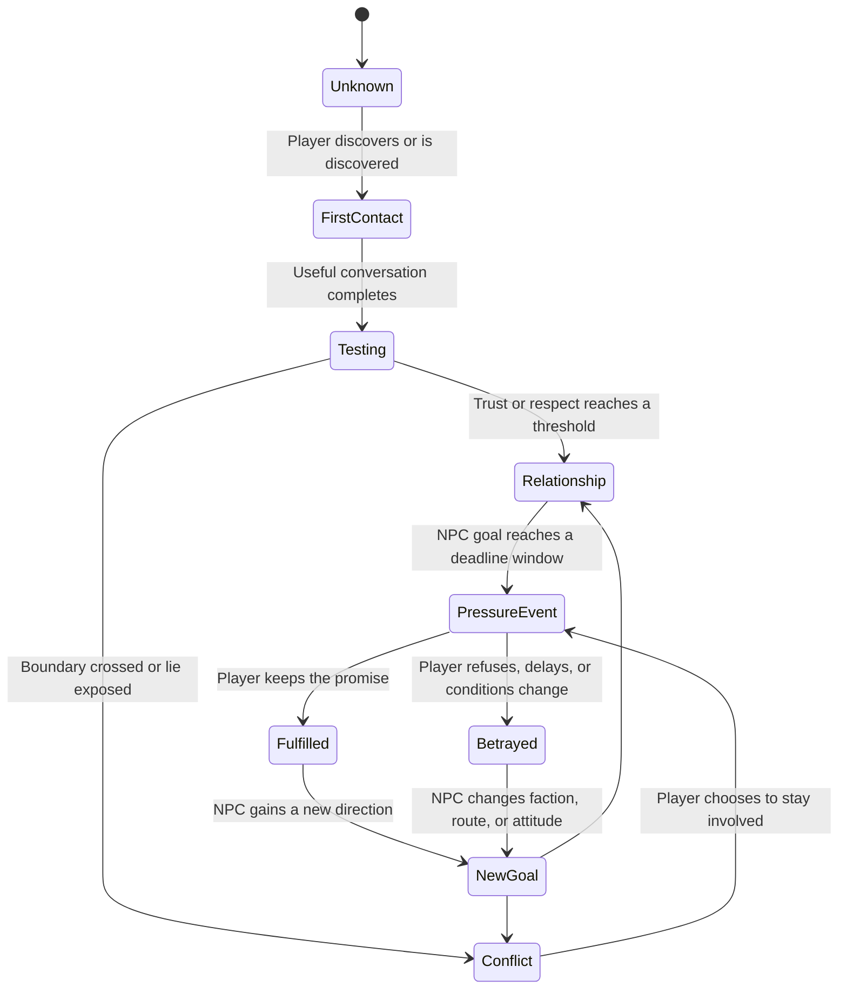
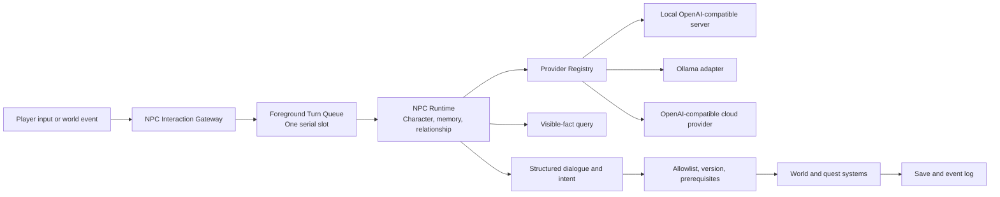

# Tide Marks: Open-World RPG and Local NPC LLM Runtime Design

> **Document type:** Game and technical design
> **Status:** Initial complete proposal
> **Date:** 2026-11-03
> **Language:** English (the [Chinese version](design.md) is also available)
> **Implementation plan:** [development-design.md](development-design.md) (Chinese)

This document describes an open-source, single-player open-world RPG in which important NPCs are driven by local or user-selected language models. The game must remain playable without an AI service. The model supplies expression and interpretation; authored content and deterministic game systems remain the source of truth.

## 1. Game Positioning

**Tide Marks** takes place in the Lingchao Archipelago after the “Great Silence,” a communications disaster that stopped the lighthouse network. Cities lost contact, identity records became unreliable, and old routes and supply systems began to fail.

The player is an **Echo Restorer** who can repair lighthouse relays. Reconnecting the network may save the archipelago, but it may also return every identity record, debt, secret, and behavior trace to a central system. Exploration, trade, investigation, and personal promises determine what kind of society returns.

The goal is not to talk to NPCs for as long as possible. Each important conversation should create an actionable choice: accept, refuse, lie, exchange, investigate, threaten, protect someone, or postpone a promise. Conversation changes relationships; relationships change information and help; those changes open or close routes and influence the ending.

## 2. Core Experience and Loop

Each 20–30 minute session should form a complete loop:

1. **Explore:** enter a region and observe its environment, relationships, and active incidents.
2. **Discover:** collect clues from objects, rumors, locations, and NPC reactions. Clues are not automatically labeled as true.
3. **Negotiate:** use free text or intent choices to ask, bargain, lie, promise, test, or refuse.
4. **Commit:** turn a conversation into a task, trade, protection deal, secret exchange, or relationship change. Promises enter the player’s promise ledger.
5. **Keep or break faith:** return to fulfill a promise or let world time advance. NPCs remember the outcome and change their behavior toward the player and others.
6. **See the consequence:** new routes, prices, allies, enemies, rumors, and story entrances become available.

The game gives the player clear goals without prescribing a single way to speak. The model expresses a response in the NPC’s voice; the rules system decides whether a task, item, route, or world change actually exists.

## 3. World Framework

The Lingchao Archipelago has four interdependent regions:

| Region | Play theme | Central conflict |
|---|---|---|
| **Tidegate Harbor** | Trade, smuggling, refugees, and information | Should scarce supplies go first to residents or newcomers? |
| **Old Ring City** | Archives, identity, abandoned government facilities, and investigation | Are old records evidence that protects people or a tool of control? |
| **Windspine Heights** | Lighthouses, energy, weather, and long-distance travel | Is reconnecting the network worth the loss of privacy? |
| **Saltmarsh Wastes** | Gathering, escorting, malfunctioning machines, and survival | Can free settlements maintain order without a central system? |

Three factions offer different answers:

- **The Lighthouse Authority** wants the old network restored for stability and efficiency.
- **The Free Tide League** wants local autonomy, restoring only essential communication and keeping personal records local.
- **The Quiet Circle** believes the old system was inherently dangerous and wants to preserve silence and independence.

These factions are not simple good and evil choices. The Authority can coordinate disaster relief but expands surveillance; the League protects autonomy but makes allocation unstable; the Circle rejects control but may leave people isolated. A single conversation should not abruptly end the main story. Key people and factions provide different routes through it.

## 4. Main Story

### Act I: The Darkened Lights

The player lands at Tidegate Harbor and repairs a low-power relay. The lighthouses were not damaged simultaneously: someone shut them down in sequence. All three factions are looking for the same **Tide Core**, but each has only part of the evidence.

The first act is about building three relationships: with someone willing to share facts, someone who needs a promise kept, and someone deliberately hiding essential information. The player learns that the same event can have several credible accounts.

### Act II: Three Truths

The player travels to Old Ring City, Windspine Heights, and the Saltmarsh Wastes to discover why the lights were shut down. Each region’s key NPCs have their own objectives. The player can help them or use their conflicts to obtain clues.

The truth is that the Great Silence was not a simple accident. An old system predicted a large conflict, locked down communication, and marked some residents as having “non-recoverable identities.” The people who shut it down may have prevented a war, but they also removed ordinary people from legal status and access to resources.

### Act III: The Return Tide

The player reaches the Tide Core and chooses one of three authored solutions:

- **Full Return:** restore the central network. The archipelago stabilizes quickly, but all old records become active again.
- **Distributed Tide Protocol:** restore only essential communication and let local communities control personal records.
- **Permanent Silence:** destroy the core. The archipelago keeps its independence but loses long-distance coordination and some old technology.

The ending is selected from authored states using faction choices, NPC survival and relationships, fulfilled promises, and regional conditions. The model never invents an ending. Its unique contribution is how each surviving NPC reacts, who stands with the player, and which routes remain open.

## 5. After the Main Story: The Post-Tide Phase

The ending is a world-state transition, not a credits screen that empties the map. Each solution opens a playable **Post-Tide** phase. The survival crisis is over, but three questions remain: who pays for the new order, who is left out, and whether the player keeps the promises made to other people.

### Ending Resolution and Save Boundaries

The authored epilogue records the player’s major choices, surviving allies, people who left or died, and unresolved promises. After it plays, the game creates a separate Post-Tide save while preserving the pre-ending save. The player explicitly chooses between **Continue in Post-Tide**, **Load Before the Ending**, and **Start a New Voyage**. Automatic saves must never silently overwrite the completed-ending save.

At minimum, the following become persistent: the chosen solution, faction relationships, regional resources and travel, NPC positions and roles, and the player’s promise and fulfillment history. A harbor may have different prices, guards, refugees, and routes under each solution. The same NPC may have a different Post-Tide life because the player helped, deceived, or abandoned them.

### Playable Post-Tide Content

- **Personal aftermath:** each key NPC has a post-ending life arc that checks the old relationship. An ally may invite the player to rebuild; a person betrayed may refuse to meet; someone afraid of the player may join an opposition movement.
- **Promise closure:** unresolved promises receive an aftermath deadline. The player can fulfill, renegotiate, or formally abandon each one, and every choice leaves a visitable result.
- **Local reconstruction:** the player can help with harbor rationing, archive returns, lighthouse duty, and settlement councils. These decisions affect prices, travel, housing, helpers, and public reputation.
- **The cost of the new order:** Full Return restores old identities but may erase people who were excluded; the Distributed Protocol creates information gaps and smuggling; Permanent Silence allows isolated communities to flourish but makes distant rescue expensive.
- **Lingering problems:** recover malfunctioning equipment, find people erased from the records, handle faction members who reject the new order, and explore routes opened by changed communication.

Post-Tide content is authored as conditional events rather than an unlimited stream of generic AI quests. Each ending has a limited set of high-quality aftermath events with two to four resolutions. Time, relationships, and regional conditions determine which ones the player can see; other events resolve through world rules. When those arcs are complete, the world enters a continuing-life mode: NPCs work, travel, and change relationships without manufacturing endless crises.

### How NPCs Live After the Ending

Important NPC goals adapt to the new world. An Authority officer may protect people reclassified by the restored system; a League mediator may handle food disputes between autonomous districts; a Quiet Circle member may confront a patient lost because communication was refused. At the start of each day, deterministic rules update plans from goals, resources, relationships, and active events. NPCs can succeed, fail, change jobs, or leave while the player is away.

The model only presents these outcomes in a personal voice. It cannot decide who dies, which faction wins, or which route opens. A player returning months later should find a community that has continued living, not characters waiting beside static quest markers.

### New Voyage

After an ending, the player may begin a New Voyage. The codex, discovered routes, ending records, and optional cosmetics may carry over. Inventory, supplies, tasks, promises, NPC relationships, death states, and the world ending reset. A normal new game must not silently preserve private relationships from another timeline. If a future “Echo Mode” uses fragments of memory, it must be clearly labeled and implemented through authored content.

## 6. NPC Design: Unique but Controllable

Each important NPC has five layers:

1. **Character sheet:** name, role, history, values, speech habits, boundaries, secrets, and long-term goals. Writers own this layer.
2. **Current state:** location, work, resources, task stage, faction position, daily plan, and current pressure.
3. **Relationship state:** trust, respect, fear, and debt toward the player. “Like” is not a sufficient single variable: an NPC may trust the player without respecting them.
4. **Memory state:** confirmed facts, recent events, promises, and records of fulfillment or betrayal.
5. **Progression state:** the NPC’s own goal, next action, deadline, and possible failure result.

Uniqueness comes from combining authored identity, player history, relationship values, current events, and the NPC’s own progression. It does not come from allowing the model to invent canon.

### NPC Progression State Machine



NPC life does not require a model call every frame or every world tick. At the start of each day, rules update the plan. A model call happens only when the player interacts, a significant event fires, or an important reaction needs to be phrased. NPCs continue their plans while the player is elsewhere and leave traceable consequences.

### Minimum Content for an Important NPC

Each important NPC should have:

- one public goal the player can understand on first meeting;
- one hidden goal discovered through behavior and clues;
- one boundary that cannot be crossed casually;
- one ability or resource that can help the player;
- one personal crisis that advances with time;
- at least three relationship outcomes, such as ally, trade partner, enemy, departure, or new faction node.

Model output must map to authored `beat_id`, `intent`, and `action` values. The model may vary wording and emotion, but it cannot create a new task, item, faction, or rule.

## 7. Conversation Gameplay

The player may enter free text or choose an intent at important moments. The game classifies the input as inquiry, negotiation, reassurance, threat, lie, promise, exchange, investigation, or end conversation, then asks the NPC Runtime for a response consistent with the NPC’s state.

Each turn returns a constrained structure:

```json
{
  "say": "I can get you into Old Ring City, but first bring my brother back from the marsh.",
  "emotion": "cautious",
  "beat_id": "offer_escort_for_rescue",
  "intent": "offer_quest",
  "action": {
    "name": "create_promise",
    "args": {"target": "rescue_brother", "deadline_days": 2}
  },
  "memory_candidates": ["Player agreed to investigate the missing people in the marsh"]
}
```

`create_promise` does not complete a task. It writes a proposed promise to the world. The player can accept, change its conditions, or refuse it. Only after the rules system validates prerequisites does the promise create a task and deadline. Breaking faith changes prices, clues, faction reputation, and future story routes.

## 8. NPC Runtime and Provider Abstraction

The game world is the only authority on facts. The NPC Runtime receives a projection of visible facts, role information, relationships, and memory. The first implementation uses one shared model slot and generates only when triggered by the player or a significant event:



Providers are selected through configuration rather than hard-coded into NPCs:

```yaml
providers:
  local:
    type: openai_compatible
    base_url: http://127.0.0.1:8192/v1
    model: YOUR_LOCAL_MODEL
    api_key_env: null
    timeout_ms: 5000
    supports_stream: true
    supports_json_schema: true

  cloud_quality:
    type: openai_compatible
    base_url: https://provider.example/v1
    model: provider-model-name
    api_key_env: NPC_CLOUD_API_KEY
    timeout_ms: 8000
    supports_stream: true
    supports_json_schema: true

default_provider: local
```

Local providers may not need an API key. Cloud providers read keys from environment variables or an operating-system secret store. Keys must never appear in NPC definitions, saves, prompts, logs, crash reports, or the repository. The open-source project does not redistribute model weights; users choose a compatible model and accept its license separately.

The default strategy is local-first with deterministic dialogue fallback. A cloud provider is optional for development, higher-quality protagonist lines, or an explicit player setting. Cloud failure must not block offline play.

The first release does not run multiple LLM inferences in parallel. Multiple requests enter a foreground queue while the game continues rendering; the NPC in the player’s active conversation has priority. Add more model slots only after measurements show that one slot cannot meet the target for voice or multiplayer features.

## 9. Memory and World Consistency

Memory has three layers:

- **Fact memory:** confirmed by the game, such as “the player returned the key.”
- **Relationship memory:** promises, fulfillment, betrayal, and deception.
- **Expression memory:** recent dialogue, forms of address, and tone preferences.

The model may propose `memory_candidates`, but it cannot write facts. World events, task submission, and promise resolution create long-term memories. A normal context includes the character sheet, visible facts, the last six dialogue turns, and relevant long-term memories. Older material is summarized through the same serial queue when the context budget is reached.

Each turn records `world_revision` and `npc_state_version` when queued. The runtime reloads state before applying a response. If a version changed, the dialogue may still be shown, but its action must be revalidated or discarded. World actions use an idempotent `turn_id` so retries cannot duplicate items, task completion, or relationship changes.

## 10. Development Stages and First Playable Slice

### Stage 1: Tidegate Vertical Slice

Build one explorable harbor, three important NPCs, one faction conflict, one missing-person task, and one lighthouse relay. The player should complete the task through different promises and reach at least three relationship outcomes. Use a local 4B-class model for text dialogue only; no voice is required.

### Stage 2: NPC Progression and Saves

Add daily plans, pressure events, the promise ledger, four-axis relationships, fact memory, and deterministic fallback. After the player leaves the harbor and advances time by two days, at least one NPC must have acted and left a visible result.

### Stage 3: Factions and Regional Links

Add Old Ring City, Windspine Heights, and the Saltmarsh Wastes. Expand faction reputation and the three main solutions. Important NPC choices should affect faction resources, final routes, and who appears in the ending.

### Stage 4: Providers and Presentation

Add configurable cloud providers, voice, facial expression, animation, and higher-quality protagonist models. Presentation upgrades must not change the world-fact or action-validation interfaces.

## 11. Acceptance Criteria

- After ten conversations with each of three important NPCs, each NPC preserves its character sheet, knowledge boundary, and confirmed facts.
- Accepting, refusing, and breaking the same promise produce observable differences in tasks, relationships, and later dialogue.
- After two days of world time, at least one NPC completes or fails its own plan without player participation and leaves a traceable event.
- Invalid actions, unknown items, expired tasks, and version conflicts never mutate world state.
- If the local model is unavailable, the player can still explore, fight, and complete rule-based tasks; only AI dialogue falls back to authored lines.
- Warm local requests target a p95 total latency below two seconds; structured-output and legal-action success targets are both 99% or higher.
- In 100 dialogue regression turns, NPCs do not reveal unauthorized secrets, invent tasks or items, or fail to return dialogue, a refusal, or an explicit wait state.
- All three main endings load into a Post-Tide world with changed faction, regional, and NPC state.
- Unresolved promises remain visible in the ledger and can be fulfilled, renegotiated, or explicitly abandoned with a visitable result.
- At least three key NPCs have relationship-sensitive personal aftermaths; ally, betrayed, and hostile states do not collapse to the same life arc.
- A New Voyage may inherit the codex and ending records, but never silently inherits old relationships, promises, or world state.
- Starting a New Voyage does not overwrite a completed-ending save, and Post-Tide exploration and NPC schedules continue without a model service.

## 12. Open-Source Boundaries

The repository should keep authored world data, schemas, deterministic simulation code, provider adapters, and tests separate from model weights and user secrets. Contributions should be possible with a local mock provider, so no contributor needs a paid API account to run the test suite.

Provider adapters must document endpoint compatibility, timeout behavior, structured-output support, and model-license assumptions. Any new tool action needs an allowlist entry, validation rules, an idempotency test, and a save/replay test. Prompts and character sheets are content assets and should be reviewed like code because they define canon and player-facing behavior.

## 13. Reference Principles

The design uses familiar engineering principles: deterministic scheduling, explicit state ownership, transactional configuration loading, truth isolation, command/event separation, session persistence, and recoverable turn execution. These are principles rather than runtime dependencies. The game should remain portable and independently buildable by the open-source community.

