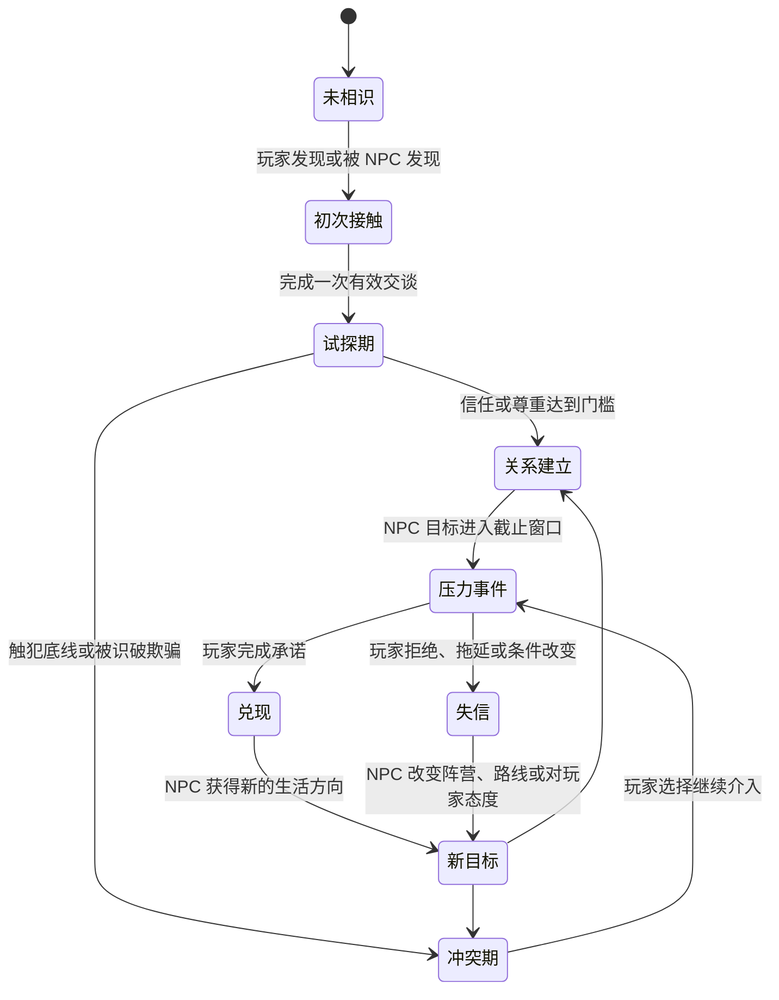
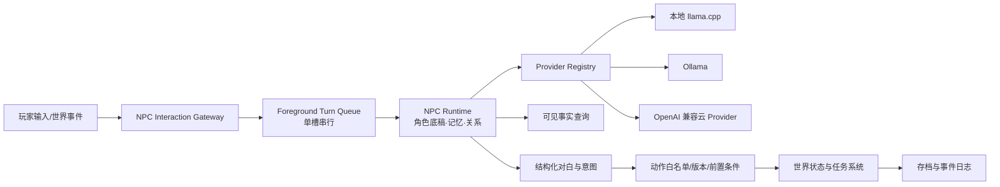

# 《潮痕》开放世界 RPG 游戏设计与 NPC Runtime 技术方案

> English version: [design.en.md](design.en.md)
> 开发实现版：[development-design.md](development-design.md)

> 文档类型：游戏设计与技术方案
> 状态：首版完整方案
> 日期：2026-11-03
> 目标：让每个重要 NPC 都拥有独立目标、记忆、关系和人生推进，同时让玩家的对话真正改变探索、任务和世界状态。

## 一、游戏定位

《潮痕》是一款单人开放世界叙事 RPG。玩家进入“临潮群岛”时，群岛刚刚经历了被称为“大静默”的通信灾难：连接各地的灯塔网络停止工作，城市之间失去联系，旧时代留下的身份记录、航线和资源分配系统逐渐失效。

玩家扮演“回声修复师”，拥有修复灯塔中继站的能力。修复网络可以让群岛重新连接，也可能把所有人的身份、债务、秘密和行为重新交给一个中央系统。玩家必须在探索、交易、调查和人与人的承诺中决定群岛恢复成什么样子。

游戏的核心不是和 NPC 聊得越久越好，而是让每次重要交谈都产生一个可执行的选择：答应、拒绝、撒谎、交换、调查、威胁、保护某人，或者把一个承诺留到以后兑现。对话改变关系，关系改变可获得的信息和帮助，帮助改变玩家能走的路线和最终选择。

## 二、核心体验和循环

游戏每次 20–30 分钟形成一个完整循环：

1. **探索**：进入区域，观察环境、人物关系和正在发生的小事件。
2. **发现**：从物品、传闻、现场和 NPC 的反应中得到线索。线索不直接标成“正确答案”，玩家需要判断可信度。
3. **交涉**：用自由输入或行动选项和 NPC 对话。玩家可以询问、谈判、撒谎、许诺、试探和拒绝。
4. **承诺**：把谈话变成任务、交易、保护、秘密交换或关系变化。承诺会写入玩家的“承诺簿”。
5. **兑现或失信**：玩家回来完成承诺，或者让世界时间推进。NPC 会根据结果改变态度、行动和对其他人的描述。
6. **回看后果**：新的路线、价格、盟友、敌人、传闻和剧情入口出现。

游戏给玩家明确的目标，但不规定唯一的谈法。模型负责让 NPC 用自己的语言表达和反应，规则系统负责决定任务、物品、路线和剧情是否真的发生。

## 三、世界框架

临潮群岛由四个互相依赖的区域组成，每个区域都提供资源、线索和不同的人际网络：

| 区域 | 玩法主题 | 关键矛盾 |
|---|---|---|
| **潮门港** | 交易、走私、难民和消息交换 | 资源应该优先给本地居民还是外来者 |
| **旧环城** | 档案、身份、旧政府设施和调查 | 旧记录是保护人的证据还是控制人的工具 |
| **风脊高地** | 灯塔、能源、气象和远距离探索 | 重新连接网络是否值得牺牲个人隐私 |
| **盐沼荒原** | 采集、护送、失控设备和野外生存 | 自由聚落能否在没有中央系统时维持秩序 |

三个主要阵营拥有不同的答案：

- **灯塔公署**希望完整恢复旧网络，以秩序和效率换取稳定。
- **自由潮盟**希望各地自治，只恢复必要通信，不交出个人记录。
- **静默会**认为大静默暴露了旧系统的危险，主张关闭核心，让人们重新学习面对不确定性。

阵营不是简单的善恶选项。公署能快速救灾，但会扩大监控；潮盟保护自由，但资源分配不稳定；静默会拒绝控制，却可能让更多人失去联系。玩家的选择会改变区域状态，但主线不会因为一次对话直接断裂；关键人物和阵营会提供不同的解决路线。

## 四、主线剧情

### 第一幕：断灯

玩家在潮门港登陆，修复一座低功率中继站。玩家发现灯塔并非同时损坏，而是有人按顺序关闭了它们。三方都在寻找同一枚“潮核”，但每方只掌握一部分信息。

第一幕的目标不是选阵营，而是建立三段关系：一个愿意分享事实的人、一个需要玩家兑现承诺的人、一个故意隐藏关键信息的人。玩家会第一次体验到“同一事件在不同 NPC 口中有不同真相”。

### 第二幕：三种真相

玩家前往旧环城、风脊高地和盐沼荒原，寻找关闭灯塔的原因。每个区域的关键 NPC 都有自己的目标，玩家可以帮助他们，也可以利用他们的矛盾取得线索。

玩家最终确认：大静默不是单纯事故，而是旧系统在预测群岛冲突时主动锁死了通信，并把一部分居民标记为“不可恢复身份”。关闭系统的人想阻止一次更大的战争，但他们也让无数普通人失去了合法身份和资源。

### 第三幕：回潮

玩家获得重启潮核的三种方案：

- **完整回潮**：恢复中央网络，群岛快速稳定，但所有旧记录重新生效。
- **分潮协议**：只恢复区域之间的必要通信，把个人记录的控制权交给各地社区。
- **永久静默**：摧毁潮核，群岛保留自由，但失去远距离协作和部分旧时代技术。

最终结局由阵营选择、关键 NPC 的存活与关系、玩家兑现过的承诺和各区域的实际状态共同决定。结局不是模型临时编写，而是由世界状态选择对应的作者内容；NPC 的独特反应决定玩家抵达结局时身边是谁、谁愿意相信玩家、哪些路线仍然开放。

## 五、主线结束后：进入“回潮后”

主线结局不是制作人员表出现后清空世界，而是一次世界状态结算。三种最终方案各自打开一个可继续探索的“回潮后”世界。此时群岛的生存危机已经解决，仍要面对三个更具体的问题：**谁来承担新秩序的代价、谁被新秩序遗漏、玩家与身边人许下的事情是否做到。**

### 结局结算与存档边界

结局章节由作者内容决定，写出玩家做过的关键选择、留下的盟友、离开或死去的人，以及尚未兑现的承诺。结算后生成独立的“回潮后”存档，并保留结局前存档；“进入回潮后”“读取结局前”“开始新航程”三个入口必须由玩家明确选择，任何自动存档都不能覆盖已完成的结局存档。

世界至少固化以下变化：最终方案、阵营关系、区域资源与交通状态、NPC 的位置和角色、玩家承诺及兑现记录。结局不是一次性过场：同一座港口会因为新秩序改变价格、守卫、流民数量和可走的路线，同一名 NPC 也会因为玩家曾经帮助或欺骗过他，拥有不同的余波生活。

### 结局后的可玩内容

- **个人余波**：每名关键 NPC 都有一条结局后的生活线。它检查旧关系，而不是重新播放主线；旧盟友会邀请玩家参与重建，失信者可能拒绝见面，恐惧玩家的 NPC 可能加入反对新秩序的人。
- **承诺收尾**：未完成的承诺进入余波期限。玩家可以兑现、重新谈判或正式放弃；每种处理都会留下可回访的结果，不允许承诺在制作人员表后无声消失。
- **地方重建**：玩家参与港口配给、档案归还、灯塔值守和聚落议事。选择会影响后续商品、通行、住处、可用帮手和 NPC 对玩家的公开评价。
- **新秩序的代价**：完整回潮会让旧身份重新生效，也会让被遗漏的人失去生活；分潮协议会产生区域间的信息差和走私；永久静默会让孤岛重新繁荣，也会让远距离救援变得昂贵。
- **旧问题余波**：收复仍失控的设备，追查被系统抹除的人，处理不愿接受新秩序的旧阵营成员，以及探索因通信变化首次开放的路线。

这些内容采用作者编写的条件事件，而不是让模型无限生成通用委托。每条主线结局准备有限数量的高质量余波事件，每个事件有 2–4 种处理方式；玩家因时间、关系和区域状态只能卷入其中一部分，其余事件会由世界规则自行演化。余波事件走完后，世界进入持续生活模式，NPC 继续工作、往来和改变关系，游戏不会为了维持任务数量而反复制造危机。

### NPC 在剧情结束后怎么生活

重要 NPC 的长期目标会转换到新世界：公署官员可能需要保护被新系统重新判定的人，潮盟调解员可能要处理自治后的粮食争端，静默会成员可能要面对拒绝通信造成的病人失联。每天开始时，NPC 按目标、资源和关系更新计划；玩家不出现时，他们仍会成功、失败、换工作或离开，并在若干天后留下结果。模型只负责把结果表现成有个人历史的对白，不能决定谁死亡、哪个阵营获胜或哪条路线开放。

这让“独一无二”延续到结局之后：NPC 记得玩家具体做过的事，也会用自己新的目标评价玩家。玩家离开数月再回来，看到的是一个已经继续生活的群岛，而不是原地等待任务标记的角色。

### 新航程

完成结局后可以开始新航程。图鉴、已发现路线、结局记录和可选外观可以继承；背包、物资、任务、承诺、NPC 关系、死亡状态和世界结局必须重置。普通新游戏不允许旧时间线的私人关系悄悄延续；如需“残响模式”，必须明确标注它是一项特殊模式，并由作者内容处理 NPC 的模糊记忆。

## 六、NPC 设计：独特但可控

每个重要 NPC 由五层组成：

1. **角色底稿**：姓名、外在身份、成长经历、价值观、说话习惯、底线、秘密和长期目标。由编剧维护，不由模型改写。
2. **当前状态**：所在位置、工作、资源、任务阶段、阵营立场、当天计划和当前压力。
3. **关系状态**：对玩家分别记录信任、尊重、恐惧、亏欠四个维度。好感不是唯一变量；一个人可以信任玩家但不尊重玩家，也可以尊重玩家却害怕玩家。
4. **记忆状态**：最近事件、已经确认的事实、玩家说过的承诺、玩家兑现或违背承诺的记录。
5. **推进状态**：NPC 自己的目标、下一步行动、截止事件和可能的失败结果。

因此，“独一无二”来自角色底稿、玩家历史、关系数值、当前世界事件和 NPC 自己的推进组合，而不是让模型随意发明背景。

### NPC 推进状态机



NPC 的生活推进不靠持续调用模型。每天开始时，规则系统根据目标、资源、关系和事件推进 NPC 的计划；只有玩家进入交互、触发关键事件或需要生成一条重要反应时，才调用模型。玩家离开一个区域后，NPC 仍然会按规则完成或失败自己的计划，回到区域时玩家能看到后果。

### NPC 的可玩内容

每个重要 NPC 至少拥有：

- 一个公开目标：玩家第一次见面就能理解的实际需求。
- 一个隐藏目标：玩家需要通过行为和线索发现。
- 一个不能被轻易触碰的底线。
- 一项可以帮助玩家的能力或资源。
- 一段会随时间推进的个人危机。
- 三种以上可能的关系结果：盟友、交易伙伴、敌对者、离开群岛或成为新的阵营节点。

模型输出必须映射到作者定义的 `beat_id`、`intent` 和 `action`。模型可以说出不同的话、表现不同情绪、提出不同的表达方式，但不能凭空创建任务、物品、阵营或世界规则。

## 七、对话玩法

玩家可以自由输入，也可以在关键时刻选择行动意图。系统把玩家输入归类为询问、谈判、安抚、威胁、撒谎、承诺、交换、调查和结束交谈等意图，再交给 NPC Runtime 生成符合角色状态的回应。

每轮对话返回以下结构：

```json
{
  "say": "我可以带你进旧环城，但你要先把我弟弟从盐沼带回来。",
  "emotion": "谨慎",
  "beat_id": "offer_escort_for_rescue",
  "intent": "offer_quest",
  "action": {
    "name": "create_promise",
    "args": {"target": "rescue_brother", "deadline_days": 2}
  },
  "memory_candidates": ["玩家答应调查盐沼失踪者"]
}
```

`create_promise` 不是直接完成任务，而是把一条承诺写入世界。玩家可以接受、改条件或拒绝。只有世界规则确认前置条件后，承诺才会生成任务和截止时间。玩家失信会被 NPC 记住，并改变后续价格、线索、阵营评价和剧情路线。

## 八、NPC Runtime 和 Provider

游戏世界是唯一事实权威；NPC Runtime 只拥有对话上下文和记忆投影。运行时采用一个共享模型槽位，玩家触发时才生成：



Provider 由配置选择，不绑定代码中的固定模型：

```yaml
providers:
  local_llamacpp:
    type: openai_compatible
    base_url: http://127.0.0.1:8192/v1
    model: Huihui-Qwen3.5-4B-abliterated.Q4_K_M
    api_key_env: null
    timeout_ms: 5000
    supports_stream: true
    supports_json_schema: true

  cloud_quality:
    type: openai_compatible
    base_url: https://provider.example/v1
    model: provider-model-name
    api_key_env: NPC_CLOUD_API_KEY
    timeout_ms: 8000
    supports_stream: true
    supports_json_schema: true

default_provider: local_llamacpp
```

本地 Provider 不需要 API Key。云 Provider 通过 `api_key_env` 读取环境变量，正式发行版使用操作系统密钥库或平台密钥服务；API Key 不写入 `configs/npcs/`、存档、日志、Prompt、崩溃报告或版本库。Provider Registry 提供 `stream_turn`、`cancel_turn`、`health_check` 和能力查询接口，NPC Runtime 不感知具体供应商。

默认策略是本地优先，服务不可用时回退到规则台词；云 Provider 作为开发调试、高质量主角对白或玩家明确开启的选项。云端不可用不能阻塞离线游戏。

首版不并行执行多个 LLM 推理。多个 NPC 同时触发时进入队列，主线程继续运行；只有当前玩家正在交互的 NPC 获得最高优先级。后续只有在实测表明单槽无法满足语音或多人需求时，才增加模型槽位。

## 九、记忆与世界一致性

记忆分为三类：

- **事实记忆**：由游戏系统确认，例如“玩家已经归还钥匙”。
- **关系记忆**：玩家答应过什么、是否兑现、是否欺骗过 NPC。
- **表达记忆**：最近几轮对白和 NPC 对玩家的称呼、语气偏好。

模型只能提出 `memory_candidates`，不能自行写入事实。世界事件、任务提交和承诺兑现才会生成长期记忆。上下文默认包含角色底稿、当前可见事实、最近 6 轮对白和相关长期记忆；超过预算后由同一串行队列生成摘要。

每个 Turn 在入队时保存 `world_revision` 和 `npc_state_version`。模型返回后重新读取世界状态；如果版本变化，对白可以保留，动作必须重新验证或丢弃。所有世界动作使用 `turn_id` 幂等提交，避免重试导致重复发物品、重复完成任务或重复改变关系。

## 十、开发阶段和首个可玩切片

### 阶段 1：潮门港垂直切片

制作一个可探索港区、3 个重要 NPC、1 个阵营冲突、1 个小型失踪任务和 1 个灯塔修复点。玩家可以通过不同的承诺完成任务，至少得到三种不同的关系结果。使用本地 Qwen3.5 4B，文本对话，无语音。

### 阶段 2：NPC 推进和存档

加入每日计划、压力事件、承诺簿、关系四轴、事实记忆和离线回退。玩家离开区域并推进两天后返回，必须能看到 NPC 自己行动产生的结果。

### 阶段 3：三阵营和区域联动

加入旧环城、风脊高地和盐沼荒原，扩展阵营声誉和主线三种方案。重要 NPC 的个人选择影响阵营资源、最终路线和结局成员。

### 阶段 4：Provider 和表现层

接入可配置云 Provider、语音、表情、动作和高质量主角模型。语音和模型升级不能改变世界事实接口和动作校验接口。

## 十一、验收标准

- 玩家与 3 个重要 NPC 各交谈 10 次后，NPC 能保持角色底稿、知识边界和已确认事实。
- 玩家接受、拒绝和违背同一承诺时，任务、关系和后续台词出现可观察差异。
- 推进两天后，至少一个 NPC 在玩家未参与时完成自己的计划或失败，并留下可追踪事件。
- 非法动作、未知物品、过期任务和版本冲突不会改变世界状态。
- 本地模型服务断开时，游戏仍可探索、战斗和完成规则任务，只把 AI 对话回退为预设台词。
- 本地暖请求 p95 总延迟目标不超过 2 秒；结构化输出通过率和动作合法率目标均为 99% 以上。
- 100 次对话回归中，NPC 不泄漏未授权秘密、不伪造不存在的任务或物品，且每轮都能产生对白、拒绝或明确的等待状态。
- 三种主线结局都能进入“回潮后”，加载后能看到对应的阵营、区域和 NPC 状态差异。
- 结局前未完成的承诺仍会出现在承诺簿中，玩家能在余波阶段兑现、重谈或明确放弃，并得到可回访的结果。
- 至少三名关键 NPC 拥有受旧关系影响的个人余波；同一角色在盟友、失信和敌对关系下不会得到同一段生活线。
- 玩家开始新航程后，图鉴和结局记录可以继承，但旧时间线的亲密关系、承诺和世界状态不会被误带入。
- 新航程不会覆盖或损坏已完成的结局存档；本地模型不可用时，“回潮后”仍可探索、推进 NPC 日程并完成规则任务。

## 十二、参考边界

`robot_simu` 只参考固定时间、独立调度、配置事务校验和状态所有权，不作为游戏框架。`BieTheirBed` 只参考 Agent Runtime 的模型步骤、工具副作用隔离、会话持久化、命令/事件分离和恢复语义。两者都不进入游戏运行时依赖。

当前本地验证服务为 `http://127.0.0.1:8192`，模型为 `Huihui-Qwen3.5-4B-abliterated.Q4_K_M`，验证记录位于 `docs/local-npc-llm/evidence/qwen35-4b-llama-cpp.json`。
