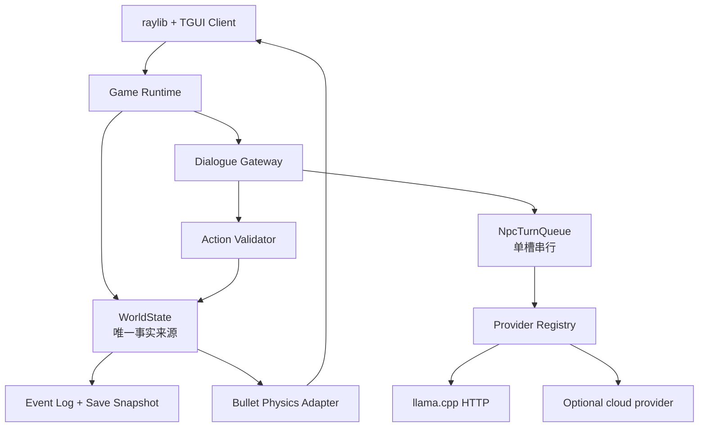
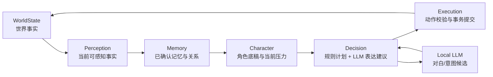
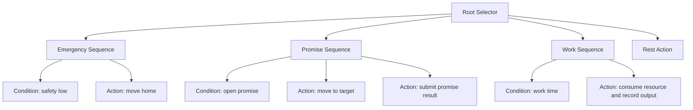
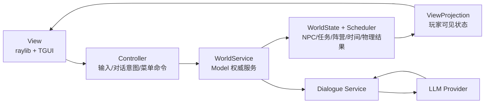

# 《潮痕》开发设计文档

> 版本：0.1 开发启动版  
> 文档性质：实现设计，不是剧情宣传稿  
> 目标：用 C++ 构建一个可离线游玩的开放世界叙事 RPG，让本地 LLM 负责 NPC 的表达和反应，让规则系统负责世界事实、任务和后果。
> 持续推进：[release-continuation-plan.md](../release-continuation-plan.md)
> 已实现状态：[implementation-status.md](implementation-status.md)

## 1. 我们究竟要做什么

《潮痕》是一款单人、3D、开放世界叙事 RPG。玩家扮演“回声修复师”，在临潮群岛调查“大静默”并修复灯塔网络。玩家不是在对话框里收集随机答案，而是在一个会继续生活的世界里与人建立关系、许下承诺、承担失信后果。

游戏的核心承诺只有两条：

1. 每个重要 NPC 都有自己的目标、记忆、底线和会随时间推进的生活。
2. LLM 不能凭空创造事实。它可以用不同的语言表达 NPC，但任务、物品、路线、死亡、阵营和结局必须由作者内容与规则系统决定。

首个可玩版本采用 3D 斜俯视/跟随相机，先完成一个港区切片；相机和资产管线不绑定玩法逻辑，后续可以扩展为第三人称探索。

## 2. 固定技术选型

### 2.1 客户端和游戏核心

- **C++20**：游戏核心、世界规则、NPC 状态、任务和存档。
- **CMake 3.25+**：构建、依赖下载、测试目标和跨平台配置。
- **raylib 5.5（CMake pinned）**：窗口、输入、2D/3D 渲染、模型、纹理、音频和相机。沿用 `robot_simu` 的轻量 Viewer 方向；后续可升级到 raylib 6.x。
- **UI adapter**：P0 使用 raylib 原生 2D HUD，避免把核心绑到系统 UI 库；P1 再接入 TGUI 1.13+（raylib backend）做对话框、任务面板、背包、关系和存档 UI。
- **Bullet 3.25**：刚体、碰撞、关节、射线查询和物理材质。采用 `IPhysicsWorld` 接口隔离 Bullet，游戏逻辑不直接包含 Bullet 类型。
- **nlohmann/json 3.11.x**：内容配置、存档快照、事件日志和结构化对话数据。

Bullet 只负责物理状态，不负责 NPC 逻辑、任务推进或剧情判断。物理步长固定为 20 ms；渲染帧率变化不能改变世界结果。

### 2.2 LLM Provider

首版使用 OpenAI-compatible HTTP 协议，默认连接本地 llama.cpp server：

```yaml
providers:
  local_llamacpp:
    type: openai_compatible
    base_url: http://127.0.0.1:8192/v1
    model: YOUR_LOCAL_MODEL
    api_key_env: null
    timeout_ms: 15000
    supports_stream: true
    supports_json_schema: true

  cloud_optional:
    type: openai_compatible
    base_url: https://provider.example/v1
    model: provider-model
    api_key_env: NPC_CLOUD_API_KEY
    timeout_ms: 8000

default_provider: local_llamacpp
```

本地客户端访问 `127.0.0.1`；`0.0.0.0` 只用于服务端监听，不能作为客户端目标。云端 API key 只从环境变量或系统密钥库读取，不写入代码、Prompt、NPC 配置、存档和日志。模型权重不随项目分发，用户自行选择并遵守模型许可证。

LLM 调用只在以下事件发生时触发：玩家开始或继续对话、玩家提交自由输入、关键世界事件要求 NPC 反应、玩家回访 NPC 时需要一段个性化回应。NPC 不会每帧调用模型，世界时间推进也不调用模型。

首版只有一个共享模型槽位。多个 NPC 同时触发时进入前台串行队列；当前玩家正在交互的 NPC 优先。超时、服务断开或结构化输出失败时使用规则台词，游戏仍能探索、战斗和完成规则任务。

## 3. 运行时分层



模块之间的边界：

- `WorldState` 保存玩家、区域、NPC、阵营、任务、物品、时间和关系，是唯一事实来源。
- `DialogueGateway` 把可见事实投影给 NPC Runtime，不把整个世界或其他 NPC 的私密内容暴露给模型。
- `NpcTurnQueue` 管理排队、取消、超时、重试和响应顺序。
- `ActionValidator` 检查动作白名单、前置条件、版本号和幂等 `turn_id`。
- `BulletPhysicsAdapter` 只把物理结果转换成游戏事件，例如“门被撞开”或“角色跌倒”；它不能直接改任务和关系。
- `EventLog` 记录事实变化。模型响应属于外部输入，回放时直接读取已记录响应，不重新请求模型。

### 3.1 六层 NPC 运行时模型

NPC 的每一轮行动必须经过六层。层与层之间只传递明确的数据结构，不能让 LLM 越过中间层直接修改世界。



#### 1. WorldState：唯一世界事实

保存时间、地点、道路、天气、物品、任务、阵营、玩家、NPC、物理对象和事件版本。它回答“世界实际上发生了什么”，不回答 NPC 是否知道或相信这件事。只有 `WorldEvent`、任务提交和经过验证的执行结果可以修改它。

#### 2. Perception：NPC 当前感知

`PerceptionProjector` 根据 NPC 的位置、视野、听觉半径、所属阵营、当前对话对象和公开信息生成感知快照。感知快照可能遗漏事实、包含延迟消息或包含错误传闻；它不能读取全局 `WorldState`。

```cpp
struct PerceptionSnapshot {
  GameTime observed_at;
  std::vector<FactId> visible_facts;
  std::vector<SoundEvent> heard_events;
  std::vector<Rumor> available_rumors;
  std::vector<EntityId> nearby_entities;
  std::uint64_t source_world_revision;
};
```

这层负责知识边界：NPC 没看见的门后事件、其他 NPC 的私密记忆和作者标记为隐藏的事实，不会进入 Prompt。

#### 3. Memory：记忆与关系

记忆不是世界事实的复制品，而是 NPC 对已经经历或听说过的内容的记录。分为：

- `FactMemory`：系统确认且 NPC 有权知道的事实；
- `EpisodeMemory`：一次交谈、帮助、欺骗、冲突或承诺的事件摘要；
- `RelationshipMemory`：对玩家的信任、尊重、恐惧、亏欠和最近一次关系变化；
- `ExpressionMemory`：称呼、语气和最近话题，用于保持连续表达。

每条记忆带有来源、时间、置信度、可见范围和衰减策略。LLM 只能返回候选记忆；`MemoryService` 根据事件来源和权限确认后才写入长期记忆。

#### 4. Character：角色身份与当前压力

`CharacterDefinition` 是作者资产，包含身份、成长经历、价值观、说话习惯、底线、秘密、公开目标、隐藏目标和可用能力。`CharacterState` 保存当前工作、阵营、资源、压力、目标阶段和情绪。角色底稿不能被 LLM 改写；状态变化必须来自世界事件或规则计划。

```cpp
struct CharacterState {
  EntityId npc_id;
  FactionId faction;
  GoalId active_goal;
  float pressure;          // 0..1
  RelationshipAxes player_relation;
  std::vector<PromiseId> open_promises;
  std::uint64_t state_version;
};
```

#### 5. Decision：决定下一步做什么

`DecisionPlanner` 分成两步：`GoalSelector` 用规则和 Utility/Score 计算 NPC 当前最重要的目标，`BehaviorTree` 把目标执行成可验证的短期动作。它先计算截止时间、资源约束和优先级，再决定 NPC 是工作、移动、交涉、等待、帮助玩家还是拒绝玩家。LLM 只参与两类决策：把玩家输入归类为对话意图，以及在已选定的 `beat_id` 内生成对白和动作候选。

NPC 的长期计划不依赖 LLM；同一世界状态必须得到同一组可行计划。模型可以提出“请求护送”或“拒绝透露姓名”，但不能提出不存在的物品、地点、任务或新规则。

行为树不是由 LLM 生成的，而是作者和程序员维护的可测试资产。它只在决策边界运行：当前区域的 NPC 可以每 2–5 Hz 更新，远端 NPC 直接跳到下一个行为树完成、失败或超时的边界。

#### 6. Execution：执行和提交

`ActionExecutor` 把决策候选转换为命令，经过白名单、前置条件、权限、版本和幂等检查后，以事务形式提交 `WorldEvent`。执行失败返回可解释原因，例如 `missing_item`、`deadline_expired` 或 `state_conflict`；失败不会部分修改世界。

典型执行动作包括 `move_to`、`start_conversation`、`create_promise`、`complete_promise`、`change_price`、`join_faction`、`leave_area` 和 `schedule_event`。物理碰撞、对话动作和离线计划都必须通过同一执行入口。

### 3.2 一轮 NPC Turn 的顺序

```text
1. 读取 world_revision 和 npc_state_version
2. 生成 NPC 的 PerceptionSnapshot
3. 查询有权限的 Memory 片段
4. 合并 CharacterDefinition、CharacterState、关系和当前 beat
5. DecisionPlanner 计算允许的 intent/action 集合
6. NpcTurnQueue 调用 LLM 生成结构化对白候选
7. 解析 JSON，拒绝未知字段、未知 beat 和未知 action
8. 重新读取世界版本，执行 ActionValidator
9. ActionExecutor 原子提交 WorldEvent 和记忆更新
10. 将最终对白、动作结果和事件 ID写入 EventLog
```

LLM 超时或不可用时，第 6 步改为作者回退台词；第 8、9、10 步不变。这样“模型负责表达”和“游戏负责执行”始终是同一条路径。

### 3.5 行为树：执行目标，而不是生成剧情

行为树节点统一返回 `Running`、`Success` 或 `Failure`。首版只实现少量节点：`Sequence`、`Selector`、`Condition`、`Action`、`Cooldown`、`Timeout` 和 `Interruptible`。



行为树的 `Condition` 只能查询 `WorldService` 的只读接口；`Action` 只能产生 `Command`，由 `ActionExecutor` 提交。树节点不直接改背包、关系或任务。玩家对话、阵营命令、受伤、承诺截止和区域关闭都可以发出 `Interrupt`，中断当前树并让 `GoalSelector` 重新选择目标。

以村务员米拉为例：她的长期目标是“维持村庄配给”，当前行为树会先检查安全，再检查未兑现承诺，然后在工作时间处理库存；如果仓库被锁、运输失败或玩家改变了配给条件，树返回 `Failure`，由规则系统记录 `LifeEvent` 并安排下一次尝试。LLM 可以把“拒绝玩家插队”说得更像米拉，但不能改变树的资源检查。

### 3.6 LLM 的确切职责

LLM 是 NPC 的**高层决策器之一**，负责在当前感知、记忆、角色目标和作者提供的候选行动中选择意图。它不是行为树本身，也不是世界事实的最终权威。行为树负责把选择变成可中断、可重试、可验证的动作，规则系统负责确认选择是否真的能发生。

| 输入场景 | LLM 可以做什么 | LLM 不能做什么 |
|---|---|---|
| 玩家自由输入 | 识别询问、谈判、威胁、承诺、拒绝等意图，提取已知实体 | 直接完成任务、发放物品或修改关系 |
| 决策边界 | 在 `DecisionContext` 的候选 `action_id` / `plan_id` 中选择，并说明动机和对白 | 创建候选之外的新动作、跳过条件检查 |
| 行为树需要表达 | 在当前 `beat_id` 和允许动作集合内生成对白、情绪和语气 | 生成新的行为树节点或直接执行副作用 |
| NPC 看到生活结果 | 把 `LifeEvent` 解释成符合角色历史的回应 | 把失败改写成成功，或凭空添加事件 |
| 重大关系变化 | 提出候选记忆和表达偏好 | 写入未经确认的事实记忆 |
| 玩家追问 | 根据 `PerceptionSnapshot` 和授权记忆回答 | 泄露其他 NPC 私密记忆或全局真值 |

运行路径是：

```text
玩家输入/生活事件
  -> WorldService：生成感知、记忆、角色目标和候选行动
  -> LLM：选择候选 action_id/plan_id，并生成动机和对白
  -> ActionValidator：检查权限、事实、资源、前置条件和版本
  -> GoalSelector/BehaviorTree：执行被批准的行动
  -> ActionExecutor：提交 WorldEvent
  -> LLM：在允许的 beat 内表达最终结果
```

当玩家只使用预设选项，或 NPC 正在执行无歧义的日常活动时，可以不调用 LLM，直接进入同一条规则路径。需要社会判断、承诺取舍、关系变化或重大事件选择时，才调用 LLM 作为高层决策器。这样 LLM 决定“这个 NPC 想选哪个可行行动”，行为树保证“行动能够按规则执行”，WorldService 保证“世界只接受合法结果”。

### 3.3 MVC 与 WorldService

项目采用以世界服务为核心的 MVC 结构，但不把它做成只适合 UI 的传统 MVC：



- **Model / WorldService**：保存并推进唯一世界状态。它提供 `submit(Command)`、`advance(GameTime)`、`query(ViewId)` 和 `save()`，所有系统通过它改变世界。
- **View**：显示 `ViewProjection`，不能直接访问 NPC 私密记忆、世界真值或 Bullet 对象。
- **Controller**：把键盘、鼠标、菜单选择和玩家自由输入转换成命令，例如 `MovePlayer`、`Interact`、`SubmitDialogue`、`Sleep`、`FastTravel` 和 `AcceptPromise`。
- **Dialogue Service**：是 Model 的一个受控子服务。它可以调用 LLM 生成对白候选，但最终仍要回到 `WorldService.submit()`。

首版 `WorldService` 和客户端在同一进程，使用 C++ 接口隔离；以后可以把它拆成独立进程或多人服务器，而不改变命令和查询协议。LLM Provider 不是 Model，也没有权限写入 Model。

### 3.4 世界什么时候推进

世界推进和玩家是否进入某个区域是两件事：

1. **游戏运行中**：只要游戏没有暂停，`WorldService` 按固定游戏时钟推进。玩家在潮门港时，旧环城和盐沼仍会通过离线规则推进。
2. **玩家进入区域**：只改变模拟精度和可见性。当前区域加载实体、导航、Bullet 碰撞和即时事件；远端 NPC 不会因为玩家没进入而冻结。
3. **游戏暂停或进程退出**：默认不推进现实时间。重新加载存档时不会根据电脑的墙上时钟自动让 NPC 过几天。
4. **明确的时间跳跃**：睡觉、等待、旅行和玩家确认的“推进一天”会调用 `advance()`，并将所有区域的离线计划推进到目标时间。

这样玩家能预测后果：没有打开游戏不会错过承诺，离开一个区域则可能错过正在发生的事情。

## 4. 代码和内容目录

```text
src/
  core/                 时间、ID、结果类型、事件、日志
  world/                WorldState、区域、时间推进、区域加载
  physics/              IPhysicsWorld、BulletPhysicsWorld、碰撞查询
  game/                 玩家、战斗、交互、任务、物品、存档
  npc/                  NPC 定义、关系、记忆、承诺、推进计划
  dialogue/             DialogueGateway、TurnQueue、动作校验
  provider/             llama.cpp、Ollama、云 Provider 适配器
  client/               raylib 窗口、相机、场景、输入
  ui/                   TGUI 对话、任务、背包、关系和结算界面
  content/              JSON 加载、Schema 校验和版本迁移
  replay/               事件回放、调试和测试夹具
data/
  world/                区域、道路、地点、资源和物理材质
  npcs/                 角色底稿、目标、秘密和对白 beat
  quests/               任务、承诺、前置条件和结果
  dialogue/             结构化 beat、拒绝、等待和回退台词
  schemas/              JSON Schema
tests/
  core/ world/ npc/ dialogue/ physics/ replay/
```

内容文件可以在不重新编译游戏的情况下修改；加载器必须拒绝未知字段类型、重复 ID、循环依赖、无效动作和缺失引用。

## 5. 世界推进

世界有三种时间：

1. **物理时间**：Bullet 固定 20 ms 步进，只处理移动、碰撞、动画触发和近场交互。
2. **游戏时间**：以分钟、小时和天推进，处理营业时间、旅行、资源消耗和 NPC 日程。
3. **事件时间**：由截止日期驱动承诺、压力事件、阵营行动和主线节点。

玩家离开区域后，NPC 不继续逐帧模拟。`WorldScheduler` 使用当前时间、目标、资源和关系计算离线结果，例如“完成护送”“错过交易”“离开港口”或“改变阵营”。玩家回到区域时，先应用离线事件，再加载 NPC 的现场状态。

区域采用分层加载：

- 当前区域：加载 Bullet 碰撞体、可见 NPC、近场事件和完整交互。
- 邻接区域：保留路线、资源和关键事件，不加载完整模型。
- 远端区域：只运行确定性的摘要计划。

NPC 的离线结果由规则系统决定，LLM 只在玩家看到结果时生成表达。这样即使 LLM 服务关闭，世界仍会推进。

### 5.1 NPC 怎么生活

NPC 不是等待玩家触发的任务点，而是拥有“生活轨道”的实体。重要 NPC 的生活由四条轨道组成：

- **生计轨道**：工作、收入、库存、住处和基本安全；
- **个人目标轨道**：寻找亲人、保护秘密、改变阵营或完成自己的长期计划；
- **关系轨道**：与玩家、家人、同事和阵营节点的关系变化；
- **压力轨道**：承诺期限、债务、疾病、追捕、资源短缺和阵营命令。

作者为每名重要 NPC 提供带条件的日程块，而不是一条永远重复的脚本：

```json
{
  "npc_id": "npc_harbor_mira",
  "routine": [
    {"from": "06:00", "to": "08:00", "activity": "check_ration_stock", "location": "harbor_warehouse"},
    {"from": "08:00", "to": "14:00", "activity": "serve_refugees", "location": "tidegate_market"},
    {"from": "14:00", "to": "18:00", "activity": "negotiate_supply", "location": "authority_office",
     "when": "faction_authority_present"},
    {"from": "18:00", "to": "22:00", "activity": "search_identity_archive", "location": "old_ring_route",
     "when": "brother_identity_unknown"}
  ],
  "fallback": "return_home_and_record_failure"
}
```

`WorldScheduler` 在每个重要时间点按以下优先级选择行动：截止压力 > 生存和生计 > 已答应的承诺 > 个人目标 > 关系维护 > 休息。行动会检查资源、路线、其他 NPC 的占用和区域状态；无法完成时生成 `LifeEvent`，例如 `missed_shift`、`promise_delayed`、`found_clue` 或 `left_area`。

玩家不在场时，NPC 使用“跳到下一个有意义事件”的压缩推演，不逐帧运行 Bullet：

```text
当前时间 -> 下一个日程/会面/截止时间
         -> 规则检查资源、路线、关系和冲突
         -> 生成成功或失败的 LifeEvent
         -> 更新 NPC 状态、区域资源和关系
         -> 继续到下一个事件
```

玩家回到区域时，系统先应用这些 `LifeEvent`，再实例化 NPC 的位置、疲劳、库存和当前目标。玩家能从 NPC 是否在岗、商店库存、路线变化、现场物品、传闻和对白中看到生活结果；系统不会默认把 NPC 的完整日程表直接展示给玩家。

NPC 分三种模拟等级：

1. **关键 NPC**：完整的角色、记忆、关系、承诺和生活轨道；
2. **支持 NPC**：共享日程模板，拥有有限关系和可追踪事件；
3. **环境 NPC**：按人口、工作和区域资源做群体统计，不为每个人保存 LLM 记忆。

LLM 只在玩家观察或参与 `LifeEvent` 时把结果表达成符合角色的对白。它可以说“我昨晚没有找到档案”，但不能自行决定“我找到了一个新物品”或“港口突然发生战争”。

## 6. NPC 数据和推进

每个重要 NPC 分成作者定义和运行时状态两部分：

```json
{
  "id": "npc_harbor_mira",
  "definition": {
    "name": "米拉",
    "role": "港口配给员",
    "public_goal": "让难民船获得今天的粮食",
    "hidden_goal": "找回被旧系统抹掉的弟弟身份",
    "boundary": ["不出卖难民名单"],
    "beats": ["first_contact", "ration_conflict", "identity_reveal"]
  },
  "state": {
    "location": "tidegate_market",
    "goal_stage": "ration_conflict",
    "pressure": 0.65,
    "trust": 0.4,
    "respect": 0.3,
    "fear": 0.0,
    "debt": 0.2,
    "npc_state_version": 12
  }
}
```

关系固定记录四个维度：信任、尊重、恐惧、亏欠。记忆分为事实记忆、关系记忆和表达记忆。模型只能提出 `memory_candidates`，长期事实必须由世界事件确认。

NPC 计划状态机至少包括：未相识、初次接触、试探、关系建立、压力事件、兑现、失信、新目标。一个 NPC 可以完成自己的计划、失败、换工作、离开区域、死亡或成为新的阵营节点；这些状态不能由模型直接决定。

## 7. 对话协议

一轮对话的输入由系统拼接，不把未经授权的世界状态交给模型：

```json
{
  "turn_id": "turn-000123",
  "world_revision": 801,
  "npc_state_version": 12,
  "player_input": "我可以替你把名单送到旧环城。",
  "visible_facts": ["旧环城北门今晚开放", "玩家持有通行证"],
  "npc_context": ["米拉的弟弟身份被抹除", "米拉不信任灯塔公署"]
}
```

模型必须返回可校验的结构：

```json
{
  "say": "那就把名单交给北门的守卫，不要交给公署。",
  "emotion": "谨慎但松动",
  "beat_id": "offer_safe_delivery",
  "intent": "create_promise",
  "action": {
    "name": "create_promise",
    "args": {
      "promise_id": "promise_mira_list",
      "target": "deliver_refugee_list",
      "deadline_game_hours": 12
    }
  },
  "memory_candidates": ["玩家提出代送难民名单"]
}
```

允许的 `intent` 和 `action` 由作者注册，例如询问、谈判、安抚、威胁、拒绝、交换、创建承诺、结束对话。`ActionValidator` 必须验证：

- `action.name` 是否在 NPC 当前 beat 的白名单中；
- 目标、物品、地点和期限是否存在；
- 玩家是否满足前置条件；
- `world_revision` 和 `npc_state_version` 是否仍然有效；
- `turn_id` 是否已经提交过。

版本冲突时可以保留对白，但丢弃动作并显示“情况已经改变”。

## 8. Bullet 物理边界

项目采用 `IPhysicsWorld` 抽象，游戏只使用 `BodyHandle`、`BodyState`、`RaycastResult` 和 `ContactEvent`。Bullet 实现放在 `physics/bullet/`，不允许 `world/`、`npc/` 或 `dialogue/` 包含 Bullet 头文件。

首版物理对象包括玩家、可推动物体、门、简单机关和碰撞地形。NPC 的日常移动使用导航和规则计划，不让 Bullet 负责几百名远端 NPC 的完整刚体模拟。近场 NPC 可以使用碰撞体，远端 NPC 使用抽象状态。

物理事件只能转换成有限的游戏事件：`player_fell`、`door_broken`、`object_moved`、`combat_hit`。所有事件仍需经过世界规则确认，不能让碰撞回调直接发放物品或完成任务。

## 9. 存档、回放和离线模式

存档由两个部分组成：

- `WorldSnapshot`：玩家、区域、NPC、任务、物品、关系和时间的完整快照。
- `EventLog`：从快照之后发生的事实事件，以及已显示的模型响应。

每个存档写入 schema 版本、内容版本、Provider 配置摘要、世界修订号和最后事件 ID。写盘使用临时文件、校验和、原子替换；结局存档、结局前存档和新航程存档分开保存。

回放模式不访问模型服务。对话直接读取事件日志中的 `DialogueTurn`，世界推进按固定时间和同一内容版本重演。这样开发者可以复现“某个 NPC 为什么改变态度”，而不会因为模型随机性得到另一种结果。

## 10. 首个垂直切片

第一阶段只制作潮门港，不先做四个完整区域：

- 可探索港区和一座低功率灯塔中继站；
- 3 个重要 NPC：配给员、走私船长、失去身份的档案员；
- 1 个失踪者任务和 1 个阵营冲突；
- 1 个可兑现、可重谈、可违背的承诺；
- 1 个物理互动：推开货箱或撞开旧门；
- 1 个本地 llama.cpp 对话 Provider；
- 规则台词回退、存档、事件日志和回放。

垂直切片的验收不是“模型能聊天”，而是：玩家用三种不同方式处理同一承诺，任务结果、NPC 关系、价格、路线和后续对白出现可观察差异；关闭 LLM 后仍可完成非 AI 玩法。

## 11. 开发阶段

### P0：可编译骨架

建立 CMake targets、依赖锁定、raylib 窗口、TGUI 面板、Bullet 适配器、JSON 加载器和空的 `WorldState`。验收：headless 测试和窗口程序都能构建。

### P1：确定性世界

实现固定时钟、区域、玩家移动、碰撞、地点、物品、任务、事件日志和快照。验收：相同输入和内容版本产生相同世界事件。

### P2：NPC Runtime

实现 NPC 定义、关系四轴、记忆、承诺簿、串行 Turn Queue、Provider Registry、结构化输出和动作验证。验收：本地服务断开时规则台词可用，非法动作零状态变更。

### P3：潮门港切片

接入 3 个 NPC、失踪任务、阵营冲突、Bullet 机关和对话 UI。验收：三种承诺结果、NPC 离线推进、存档和回放全部可复现。

### P4：主线和余波

加入四区域、三阵营、三种主线方案和“回潮后”阶段。验收：结局后世界可继续探索，至少三名 NPC 的余波受旧关系影响。

### P5：表现和 Provider 扩展

加入动画、语音、云 Provider、模型能力检测和更高质量的表现层。表现升级不能修改世界事实接口和动作校验接口。

## 12. 开源工程约束

- 不提交模型权重、API key、个人存档和本地地址以外的私密配置。
- 每个新动作必须同时添加白名单、前置条件、幂等测试和回放测试。
- 内容资产使用 JSON Schema 校验，ID 全局唯一，引用必须可解析。
- LLM Provider 必须可以被 mock；贡献者不需要云 API 才能运行测试。
- Bullet、raylib、TGUI、nlohmann/json 的许可证和版本写入 `THIRD_PARTY_NOTICES.md`。
- 文档、构建和测试流程保持在仓库内，贡献者不依赖外部工单系统即可开发。

## 13. 首批验收命令

项目骨架建立后，根目录提供以下标准命令：

```bash
cmake --preset default
cmake --build --preset default
ctest --test-dir build --output-on-failure
./build/tide_marks --provider local_llamacpp --scene tidegate_harbor
./build/tide_marks_headless --scene tidegate_harbor --days 2 --replay /tmp/tide_marks.jsonl
```

其中 headless runner 不依赖显示器或 LLM 服务，用于验证世界推进、存档、动作校验和回放；桌面客户端只负责把同一份运行时状态呈现给玩家。

## 14. 业界最佳实践与本项目采用方式

### 14.1 生成式 NPC 的记忆闭环

公开研究《Generative Agents: Interactive Simulacra of Human Behavior》验证了四个关键组件：观察、记忆检索、反思和计划。我们借鉴其结构，但把“世界事实”和“模型生成”分开：

- 观察对应本项目的 `PerceptionSnapshot`；
- 记忆检索对应带权限和来源的 `MemoryService`；
- 反思只在承诺完成、重大失败或关系转折时触发，生成候选摘要，不直接改事实；
- 计划由 `WorldScheduler` 和 `DecisionPlanner` 决定，LLM 只提供对白和受限意图。

这避免了每个 NPC 持续调用模型，也避免把模型的幻觉当成世界事件。

### 14.2 分层状态机和行为树

大型游戏 AI 常用层级状态机、行为树或 Utility/Score 选择器，把“长期目标”“当前活动”和“动作执行”分层。我们的等价实现是：

```text
长期目标：养活家人 / 查找身份 / 保护村庄
    ↓
压力状态：截止、资源短缺、冲突、受伤、被追捕
    ↓
活动状态：工作、移动、交涉、休息、跟踪、回家
    ↓
可执行动作：移动、交易、创建承诺、拒绝、离开
```

状态转换由条件和事件触发，有作者定义的终止条件、失败条件和回退状态。LLM 不生成状态机结构。

### 14.3 远近分层和事件驱动

大型开放世界不会让所有角色一直运行完整物理和完整 AI。我们采用三档模拟 LOD：当前区域完整运行、邻接区域运行轻量日程、远端区域跳到下一个有意义事件。所有档位共享同一个 `LifeEvent` 和 `WorldEvent` 格式，因此 NPC 进入视野时不会出现两套互相矛盾的结果。

### 14.4 结构化输出、动作白名单和回退

生产级 AI 系统通常把自然语言和副作用分开。每轮对话使用固定 JSON Schema、枚举化 `intent`、作者注册的 `beat_id` 和动作白名单；解析失败、超时、版本冲突和 Provider 断开都回退到作者台词。任何工具调用都经过权限、前置条件和幂等检查。

### 14.5 可回放评测和内容版本

模型输出具有随机性，不能只靠人工试玩判断质量。每个验证场景保存输入、可见事实、NPC 状态版本、模型响应、验证结果和最终事件。回放不重新调用模型。内容版本、Prompt 版本、Provider 名称和模型名写入测试工件，避免同一场景在不同版本下无法比较。

### 14.6 我们明确不采用的做法

- 不让 LLM 每帧思考或驱动所有 NPC 的移动；
- 不让 LLM 直接创建物品、任务、地点、阵营或死亡结果；
- 不把完整世界状态塞进 Prompt；
- 不用无限生成的普通委托掩盖缺少作者内容；
- 不把现实墙上时钟作为单机世界推进依据；
- 不以“说话像人”作为唯一验收标准，必须验证世界状态和事件结果。

## 15. P0 验证场景：三 NPC 小村庄

可以开始开发，但第一步不做四区域完整开放世界，而是制作一个**可扩展的三 NPC 小村庄垂直切片**。它不是一次性 Demo，而是生产架构的最小闭环。

### 15.1 场景规模

- 一个可步行村庄：广场、仓库、码头、诊所、三间住处；
- 一个公共资源：连续两天只能满足两项需求的粮食或药品；
- 三个重要 NPC，彼此有依赖和冲突；
- 一个可探索的村外地点，用于制造时间和路线压力；
- 一个承诺任务，支持接受、改条件、拒绝和违约；
- 一个可见的物理互动，例如打开仓库门或推动货箱；
- 一个本地 LLM Provider 和完整规则台词回退。

### 15.2 三个 NPC

1. **村务员米拉**：负责配给，公开目标是让村民撑过两天；隐藏目标是保护一名没有身份记录的家人。她掌握库存和配给价格。
2. **摆渡人洛恩**：负责码头和村外路线，公开目标是修好船；他欠米拉一笔债，也知道村外有人在寻找失踪者。
3. **档案员伊芙**：在诊所整理旧记录，公开目标是找到药品来源；她不信任米拉，掌握能证明家人身份的线索。

三人形成关系三角：米拉需要洛恩的运输，洛恩需要伊芙的零件记录，伊芙需要米拉开放仓库。玩家帮助其中一人，会改变另外两人的资源、信任和行动安排。三人比两个 NPC 多出一个关键验证维度：NPC 与 NPC 之间的关系会在玩家缺席时继续变化。

### 15.3 可验证流程

```text
第 1 天上午：玩家认识三人，分别获得三个互相冲突的请求
第 1 天下午：玩家选择接受、重谈或拒绝一个承诺
第 1 天夜晚：玩家睡觉，WorldScheduler 推进村庄事件
第 2 天：玩家回到村庄，观察库存、岗位、路线和关系变化
第 2 天晚上：玩家兑现或违约，触发三人的不同反应
回放：关闭 LLM，使用 EventLog 重现同一结果
```

### 15.4 P0 验收门槛

- 三个 NPC 各有独立日程、公开目标、隐藏目标、底线和失败结果；
- 同一玩家承诺的接受、拒绝、改条件和违约产生四种可观察后果；
- 玩家离开村庄并推进两天后，至少两个 NPC 在没有玩家参与时改变位置、资源或目标阶段；
- NPC 能引用自己有权限看到的事实，不能知道玩家未公开的其他 NPC 私密内容；
- 同一输入、同一内容版本和同一事件日志可以得到一致的世界结果；
- LLM 服务关闭时，规则台词、任务、时间推进、存档和回放仍然可用；
- 结构化动作、过期承诺和版本冲突都有自动化测试；
- 三 NPC 的本地模型暖请求 p95 总延迟目标不超过 2 秒，超时有可见回退提示。

达到这些门槛后，才扩展到四区域和三阵营。扩展时只增加内容和规则数据，不改变 `WorldService`、NPC Turn 协议、`ActionExecutor` 和回放格式。

### 15.5 参考资料

- [Generative Agents: Interactive Simulacra of Human Behavior](https://arxiv.org/abs/2304.03442)：观察、记忆、反思和计划的生成式 NPC 架构。
- [Unreal Engine StateTree](https://dev.epicgames.com/documentation/en-us/unreal-engine/state-tree-in-unreal-engine)：层级状态机与选择器/转换的生产实践。
- `robot_simu` 的早期 Bullet 物理适配、raylib/TGUI 客户端和 headless 回放测试：作为 C++ 工程实现参考，不作为本项目运行时依赖。

